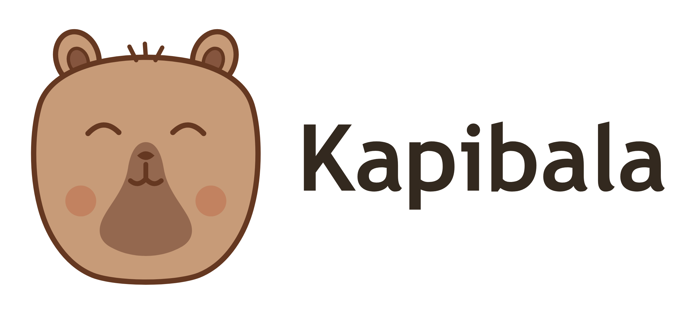

<div align="center">

  <picture>
    <source media="(prefers-color-scheme: dark)" srcset="assets/logo-dark.png" />
    
  </picture>

  **心如止水，稳定如初 —— AI Agent Harness**

  <p><a href="package.json"></a> <a href="https://www.typescriptlang.org/"></a> <a href="https://nodejs.org/"></a> <a href="https://pnpm.io/"></a> <a href="https://vitest.dev/"></a> <a href="https://biomejs.dev/"></a> <a href="LICENSE"></a></p>

  <p>
    <a href="#-快速开始">快速开始</a> •
    <a href="#-cli-kpbl">CLI</a> •
    <a href="#-桌面客户端-v010-未签名自用版">桌面客户端</a> •
    <a href="#-sdk-一分钟接入">SDK</a> •
    <a href="#-了解更多">文档</a>
  </p>

</div>

---

## 📖 简介

**Kapibala**（水豚，命令为 **`kpbl`**）是一个从零构建的 TypeScript AI Agent Harness 与交互式 CLI。正如卡皮巴拉以"情绪极其稳定、友善包容万物"著称，它为大模型 Agent 提供：

- **心如止水**：工具事务闭合、历史修复、预算检查与摘要失败熔断；只在明确且尚无输出的上下文超限拒绝后尝试一次重发，不自动重放工具副作用；
- **连接万物**：规范消息模型与可插拔扩展架构，解耦厂商差异；内置 **8 家厂商 / 20 个模型**（DeepSeek、OpenAI、Anthropic、Gemini、通义千问、Kimi、智谱、本地 Ollama），支持 OpenAI Chat Completions 与原生 Anthropic Messages / OpenAI Responses 协议；
- **开箱即用**：一条命令启动的交互式终端，同一套 Harness 复用给桌面客户端与 Headless SDK。

## 🚀 快速开始

需要 Node.js 20+。

```bash
# 临时运行 CLI（首次运行会引导配置模型和 API Key）
npx @kiturone/kapibala-cli

# 或全局安装后在任意目录使用 kpbl
npm install -g @kiturone/kapibala-cli
kpbl
```

在自己的项目中使用 Headless SDK：

```bash
npm install @kiturone/kapibala          # Core SDK
npm install @kiturone/kapibala-mcp      # 需要接入 MCP 生态时（CLI 已内置挂载）
```

包页面：[CLI](https://www.npmjs.com/package/@kiturone/kapibala-cli) · [Core SDK](https://www.npmjs.com/package/@kiturone/kapibala) · [MCP 扩展包](https://www.npmjs.com/package/@kiturone/kapibala-mcp)。

## 🖥️ CLI (`kpbl`)

单命令启动的交互式终端：打字机流式输出、思考链高亮、Slash 命令系统、冷启动配置向导、按厂商族共用的密钥管理、会话分支与后台子代理。

```bash
kpbl                             # 交互式会话终端 (REPL)
kpbl "查看当前目录结构"          # 免交互单次问答
kpbl --continue                  # 继续最近会话
kpbl -m deepseek-v4-pro          # 指定模型启动
kpbl --permission plan           # 本次会话权限: approval|plan|auto|full-access
```

会话内常用命令（完整 40+ 条清单见 [CLI 指南](docs/cli.md)）：

| 指令 | 作用 |
|---|---|
| `/model` | 交互式模型菜单（两步选择，标注密钥状态） |
| `/history` · `/resume` | 历史列表与续答（`--tree` 分支树、`--search` 全文检索） |
| `/new` | 新建独立会话 |
| `/permissions` | 查询或切换权限模式 |
| `/mcp` · `/skills` | MCP 服务与技能状态 |
| `/agents` | 观测后台子代理任务树 |

生成中 `Ctrl+C` 优雅中断并修补历史；密钥按厂商族共用（一个厂商只需配置一次），自定义端点按 host 隔离。完整命令行选项、冷启动向导示例与快捷键规范见 **[docs/cli.md](docs/cli.md)**。

## 🎨 桌面客户端 (v0.1.0，未签名自用版)

基于同一 Agent Harness 的 Electron 桌面应用：单个 utilityProcess Agent Host 复用 Core 与 MCP，React 沙箱渲染层只接收脱敏展示数据，主进程不直连引擎。

- **会话体验**：默认空间与项目空间（二次信任确认）、多会话历史（重命名、置顶、归档与删除）、流式 Markdown、思考折叠、按需展开的工具详情抽屉；
- **控制与安全**：工具调用审批与取消清理、崩溃后保留人工恢复栅栏（不自动重发未确认任务）、模型与凭证设置与 CLI 共用同一份配置；
- **系统集成**：原生窗口、系统托盘、原生通知、三态主题（浅色 / 深色 / 跟随系统）。

> **已发布（未签名个人自用版）**：签名与公证、跨平台安装包不随本版验收，随 Release 附带的只有维护者本机打出的 macOS arm64 测试包（首次打开需右键或 `xattr -dr com.apple.quarantine`）。口径见 [桌面发布流程](docs/desktop-release.md)，交付与已知限制见 [发布说明](docs/releases/v0.1.0.md)。也可从源码体验：

```bash
pnpm dev:desktop     # 开发模式（热重建，使用本机 ~/.kapibala 配置）
pnpm try:desktop     # 打包测试版客户端并以隔离沙箱启动（不触碰真实用户数据）
```

功能范围与开发入口见 [docs/desktop-development.md](docs/desktop-development.md)，设计方案见 [design/004](docs/design/004-v0.1.0-desktop-harness.md)。

## 🧩 SDK 一分钟接入

`@kiturone/kapibala` 是 Headless 核心：模型循环、工具、历史、Hook 与结构化 `SessionEvent`，不含任何终端 / GUI 组件。

```typescript
import { AgentSession, OpenAICompatibleProvider, builtinTools } from '@kiturone/kapibala';

const session = new AgentSession({
  workspaceRoot: process.cwd(),          // 必填且必须是绝对路径
  defaultProfile: profile,               // 模型配置（协议由 profile.provider 决定）
  defaultProvider: new OpenAICompatibleProvider({
    baseURL: 'https://api.deepseek.com/v1',
    apiKey: process.env.DEEPSEEK_API_KEY,
    modelName: 'deepseek-flash',
  }),
});
for (const tool of builtinTools) session.tools.register(tool);

await session.init();
for await (const event of session.run('请帮我统计当前目录下的文件')) {
  if (event.type === 'text_delta') process.stdout.write(event.text);
}
await session.destroy();
```

自定义工具、Hooks、持久化、多角色路由与原生协议接入见 **[docs/sdk.md](docs/sdk.md)**。

## 🗂️ 了解更多

| 文档 | 内容 |
|---|---|
| [配置系统](docs/configuration.md) | 配置优先级、`$schema` 补全、内置模型清单与自动升级 |
| [CLI 使用指南](docs/cli.md) | 全部命令行选项、Slash 命令、向导与快捷键 |
| [SDK 使用指南](docs/sdk.md) | 完整接入示例、自定义工具、Hooks、角色与协议 |
| [架构设计](docs/architecture.md) | 模块分层、执行循环与宿主复用边界 |
| [MCP 使用指南](docs/mcp.md) | MCP 服务的配置、授权与命令入口 |
| [技能体系](docs/skills.md) | 技能使用与宿主边界 |
| [本地宿主](docs/local-host.md) | `kpbl daemon` / `connect` / `serve --stdio` |
| [模型与协议](docs/models/openai-compatible.md) | OpenAI 兼容 / Anthropic / Responses 协议细节与输出预算 |
| [SDK 兼容性](docs/sdk-compatibility.md) | 公开 API 的兼容承诺与差异登记 |
| [版本与路线图](docs/RELEASES.md) | 各版本能力明细、发布记录与路线图 |
| [桌面开发指南](docs/desktop-development.md) | 桌面端功能、开发入口与故障测试 |

## 🧪 开发与本地测试

克隆仓库后，**一条命令**完成依赖安装、编译、校验并进入交互会话（运行当前源码）：

```bash
pnpm dev        # 环境预检 → 依赖 → 链接自愈 → 编译 → 校验 → REPL
```

| 命令 | 说明 |
|---|---|
| `pnpm dev` | 一键：依赖 → 链接自愈 → 编译 → 校验 → REPL |
| `pnpm dev:build` | 编译 + 校验，不启动 REPL |
| `pnpm verify` | 完整门禁：typecheck → test → lint（含密钥扫描） |
| `pnpm test` / `pnpm test:watch` | Vitest 全套单测 / 监听模式 |
| `pnpm dev:desktop` | 桌面客户端开发模式（热重建） |
| `pnpm try:desktop` | 打包测试版桌面客户端并隔离启动 |
| `pnpm check-secrets` | API Key 凭证防泄露扫描 |
| `pnpm lint` / `pnpm format` | Biome 风格检查 / 自动格式化 |

常用开关：`--no-start`（构建+校验后不启动）、`--verify-only`（只跑校验）、`--clean`（从零重建）。完整清单以 `node scripts/dev.mjs --help` 为准。

## 📄 开源协议

本项目采用 [MIT License](LICENSE) 开源协议。
