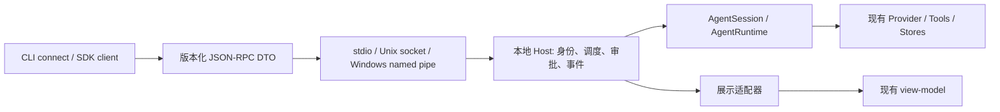

# Kapibala v0.0.9 技术方案：本地客户端契约与发布前加固

日期：2026-10-19。状态：已按用户确认的“不新增 npm 包”方向落实设计，进入实施规划；P0–P3 已编码，当前平台验收通过；完整发布门禁仍在进行。资源上限与工期仍为工程初值，验收后记录调整。

2026-10-21 后续规划调整：v0.0.9 已发布，最新发布与剩余验收以 [验收记录](../verification/v0.0.9.md)为准；本文保留当时设计上下文。下文原称 v0.1.0 的稳定整合改为 [v0.0.10](003-v0.0.10-stable-integration.md)，原称 v0.1.1 的 Electron 桌面端改为 v0.1.0，现役编号见 [路线图](../RELEASES.md)。

## 1. 版本定位与现状

v0.0.9 将已有 Headless Agent Harness 变成可被独立本地客户端可靠连接的运行服务，交付“连接 → 打开会话 → 运行 → 流式观察 → 审批 → 取消 → 重连”的闭环。v0.1.0 负责契约稳定与整合，Electron 客户端仍放在 v0.1.1。

依据：当前 package.json 为 0.0.8；docs/RELEASES.md 已确定 v0.0.9 的本地契约方向；Core 已有 AgentSession、SessionManager、ApprovalChannel、WorkspaceLeaseCoordinator 与任务观察；CLI 已有 SessionPresentation、PresentationStore 和浏览器可用的 view-model 子路径。

关键缺口：进程内 SessionEvent 不能直接当作稳定 wire 协议；ApprovalChannel 含 Promise/AbortSignal，不能直接跨进程；展示状态有 viewEpoch 等身份隔离需求；会话存储锁不等于客户端控制权；取消请求返回不等于工具事务已闭合。

本版不交付：桌面/Web/移动 UI、HTTP/WebSocket 远程监听、跨机器访问、OS 后台服务安装与自动更新、完整事件日志持久化、重启后自动继续工具、Git Worktree 隔离、全屏 Ink TUI。v0.0.8 发布说明提到全屏交互“下一版”，与路线图主线有歧义，建议将其明确排到独立后续版本；不能默认挤入本版。

## 2. 开源参考与取舍

以下结论来自用户 aigc 目录的本地源码快照，未联网确认最新版；只借鉴机制，不复制项目架构或引入其框架依赖。

| 本地参考 | 已观察机制 | 本项目取舍 |
|---|---|---|
| codex/codex-rs/app-server-protocol/src/protocol/common.rs | initialize、独立 ServerRequest、command/file approval 请求 | 采用初始化协商、双向 RPC 和请求 ID；不引入 Rust daemon 安装体系 |
| pi/packages/coding-agent/src/modes/rpc/rpc-types.ts | prompt/abort/get_state 与结构化命令协议 | 采用小型本地 RPC；不直接输出整个进程内事件联合类型 |
| pi/packages/coding-agent/src/modes/rpc/jsonl.ts | StringDecoder 与 LF 分帧，避免 Unicode 分隔符误切 | 采用 UTF-8 增量解码并补充帧长、缓冲与非法输入限制 |
| opencode/packages/server/src/event-feed.ts | 有界订阅队列、SubscriberOverflowError | 采用显式背压失败与快照恢复；不引入 HTTP/SSE 或 Effect |
| PiDeck/src/main/pi/AgentManager.ts | abort gate、超时兜底、进程退出分类、请求状态跟踪 | 分离取消确认与运行终态；生命周期逻辑拆小模块，不建立巨型 Manager |

参考根目录：/Users/kiturone/Documents/Project/aigc。实现前按各项目 LICENSE 检查任何拟复制代码；本方案没有复制实现。

三种候选：stdio-only 最小但不能支持独立持久宿主；HTTP/WebSocket 方便浏览器但扩大网络安全与依赖范围；推荐 JSON-RPC 2.0 + 本地 socket，复用同一 codec 提供 stdio 模式。stdio 用于父进程托管，socket 用于独立 daemon。

## 3. 模块与依赖

保持 Core、CLI、MCP 三个发布包，不新增 packages/protocol 或 packages/local-host。CLI 内新增 src/protocol/（纯 DTO、JSON Schema、轻量边界校验）、src/local-host/（会话装配、调度、审批、事件）、src/transport/（stdio、socket、分帧）、src/client/（请求关联、订阅、重同步）。local-host 依赖现有 Core/MCP；Core 不反向依赖 CLI。

协议通过 @kiturone/kapibala-cli/protocol 子路径独立构建，只导出 JSON 安全 DTO、Schema、校验器和协议常量，不导入 Node、Core 运行实现或终端模块。JSONL 字节分帧依赖 Node，放 transport/ 而非 protocol/。客户端通过 @kiturone/kapibala-cli/client 导出，为 Node 环境入口；未来浏览器只消费 protocol/view-model，由各自宿主提供传输。子路径导入不能触发 bin、REPL、配置读取或进程启动。

新增 tsup.protocol.config.ts、tsconfig.protocol.json 和协议边界检查，沿用 view-model 的独立 browser 构建方式；主构建先清理 dist，再生成 protocol/view-model/client 产物，子构建只能清理各自目录。功能模块边界通过导入检查和测试保持，无需独立 npm 包。

保留 CLI 直接运行模式为默认。新增 kpbl serve --stdio（随父进程结束）和 kpbl daemon start|status|stop、kpbl connect（显式连接本地服务）。daemon 启动使用现有 Node 可执行文件与已构建入口，不经 shell 拼接命令；start 应等待健康握手成功再报启动成功。避免增加第二个 AgentLoop 或复制 Core 安全策略。

现有 commands 仍含 CLI 宿主上下文，不能直接暴露任意 Slash 命令执行 RPC。本版连接模式仅承诺会话列表/打开、文本提交、状态、审批、取消和退出；模型/模式/技能等高级修改暂用直接 CLI。连接模式帮助须清晰说明支持范围。

## 4. Wire 契约

使用 JSON-RPC 2.0，不支持 batch。request id 为连接内唯一字符串；双向请求使用 c:/s: 前缀区分。notification 不带 id。所有边界从 unknown 做运行时验证，禁止 TypeScript 强制断言代替校验。

initialize 提交 protocolMajor=1、支持的 minor 区间、clientName、凭证和能力列表；响应选择确切版本、serverInstanceId、clientId、限制与能力。完成初始化前只接受 initialize。major 不兼容拒绝；minor 取交集；能力不支持明确失败。产品版本 0.0.9 与协议版本独立。新增可选字段必须有默认行为，未知事件不得推进客户端已应用游标。

| 方法 | 语义 |
|---|---|
| initialize / ping | 初始化与健康检查 |
| session/list、session/create、session/open | 列表分页；创建或打开显式 workspaceRoot 下的会话 |
| session/close | 控制者在 idle 时销毁会话资源并释放句柄 |
| session/attach、session/detach | 观察订阅；声明 control 或 observe，返回快照与游标 |
| run/start | 返回 runId 与 accepted，终态通过事件报告 |
| run/cancel | 目标 runId；返回 cancellationRequested，不宣称已经停止 |
| session/snapshot | 获取有界展示快照、运行状态、待审批与高水位 |
| approval/request | 服务端向控制客户端发出的 RPC，请求人工决策 |
| host/shutdown | 经同用户认证的显式 daemon 停止；等待清理 |

run/start 示例 params：{sessionId, streamEpoch, controlEpoch, clientOperationId, input}。服务器从 sessionId 解析已绑定工作区，后续运行不能覆盖 root。clientOperationId 在当前 serverInstanceId/session 内缓存去重结果；同 ID 不同参数拒绝。每会话最多保留 1024 个已接收操作 ID，不在会话存活期间淘汰；满后仅允许已有 ID 查询/重试，新 ID 返回 RESOURCE_LIMIT，用户需关闭并重新打开会话。重新打开生成新的 streamEpoch，启动请求必须匹配该代际；旧代际请求拒绝，不能当成新任务执行。跨重启不保证 exactly-once，客户端必须先查状态/历史，不能自动重发写任务。

服务端事件统一包络：{serverInstanceId, sessionId, streamEpoch, seq, runId?, type, payload}。seq 只在同一 session/streamEpoch 内单调，request id、tool call id 与 seq 不混用。内部 SessionEvent 通过白名单 projector 映射，剔除 Provider 私有块、凭证、堆栈与不受控对象；模型文本为明确用户内容，错误/工具参数另做脱敏，不宣称扫描可消除用户文本中的所有秘密。

错误采用标准 JSON-RPC 错误码加 data.code，业务码至少包括 PROTOCOL_MISMATCH、UNAUTHORIZED、SESSION_BUSY、CONTROL_REQUIRED、STALE_CONTROL、APPROVAL_EXPIRED、RESYNC_REQUIRED、RESOURCE_LIMIT、SHUTTING_DOWN。错误不回显凭证或完整原始请求。

## 5. 会话所有权、审批与取消

daemon 内 SessionRegistry 按规范化 workspaceRoot + conversationId 管理句柄，一个会话仅一个控制连接，可有多个只读观察者。SessionManager 的跨进程单写者锁继续生效；直接 CLI 已占用的会话明确 SESSION_BUSY，daemon 不偷锁。WorkspaceLeaseCoordinator 按工作区共享于该宿主持有的相关会话，仍由 Session 持有租约，不改为进程全局单例。

controlEpoch 是每次控制权授予生成的不可复用身份；变更操作必须匹配它。观察连接只能接收脱敏事件/快照，不能审批或运行。控制连接断开：立即取消待审批并触发在途运行取消，等待 Core 清理；清理完成才能重新授予控制权。观察者断开不影响运行。v1 不支持断线后继续无人值守写任务和主动抢占控制权。

RpcApprovalChannel 实现现有 ApprovalChannel。服务端持有原始 ApprovalRequest，发给控制端的是脱敏展示 DTO、approvalId、runId、controlEpoch、目标摘要和到期时间。客户端只回复五选一 ApprovalChoice，不能修改工具参数。服务端验证归属、有效期、控制代际和请求仍 pending；重复/迟到回复拒绝。原始参数与执行身份绑定留在服务端，由现有执行器复核与缓存，会话允许范围继续遵守 sessionAllowed。脱敏后若无法展示足以理解执行目标的信息，拒绝该审批，不能要求盲批。

审批超时默认 120 秒；断线、AbortSignal、运行终止、daemon 停止都 settle 为 cancel 并清理 pending。Core 无通道拒绝规则不变。子代理继续通过既有宿主能力走同一个审批桥，不开可绕过父任务策略的新通道。

取消状态：running → cancelling → completed/failed/cancelled。结束事件仅在事件迭代器清理、工具结果闭合落盘后发送；与自然完成竞争时保留真实完成结果。host/shutdown 先拒绝新运行，再撤销审批、取消运行、等待清理、destroy 与释放句柄。超时报告 shutdown_failed 并保留诊断状态，不伪造干净停止。强制杀死的极端恢复继续遵循 OUTCOME_UNKNOWN，不重放工具。

## 6. 快照、重连与流控

本版不提供跨连接的事件重放或持久事件日志；重连一律通过逻辑快照重建。canonical store 仍是历史真源；展示 reducer 从消息投影和活动状态恢复。

attach 在同一会话串行调度队列内捕获快照高水位 N、建立订阅，然后发送 snapshot(N) 和 seq>N 的事件，防止快照/订阅之间丢消息。逻辑快照包含已完成历史、活动运行尾部与 pending approval 摘要，按同一 revision 的 64Ki UTF-16 码元块传送；客户端取得完整逻辑快照前不得应用后续事件。快照按编码字节整体计量，不提供按消息条数的分页参数；revision 过期或游标非法返回 RESYNC_REQUIRED，要求重新 attach。

新 serverInstanceId、缺少或过期游标一律走重建，不将旧审批或运行恢复为活动。客户端重复 seq 忽略；缺号不能跳过，必须停止应用并重新 attach 获取快照。恢复展示不自动恢复控制或重发 run/start，也不自动重放写任务。

建议默认上限（工程初值，验收可调但须记录）：单帧 1MiB、未初始化 5 秒超时、每连接 64 个在途请求、16 个连接、8 个打开会话、4 个同时运行、每会话 128 个 pending approval、每连接快照总预算 8MiB、发送队列 4MiB、每会话 1024 个已接收操作 ID。所有数值在服务端集中定义并通过握手公布。超限拒绝，不静默截断合法 JSON。

UTF-8 增量解码、LF 分帧并兼容 CRLF；U+2028/U+2029 不分帧；EOF 半帧报错。大工具结果使用有界预览，单个输出过大返回明确 truncated 元数据，不在流中塞无限字符串。Node write(false) 等待 drain，但读循环必须继续处理审批回复和 cancel；队列溢出关闭慢连接并要求重新 attach，不无限缓冲。发送中的实时事件也必须经过相同脱敏投影。

## 7. 本地传输与安全边界

POSIX 使用用户私有目录内 Unix domain socket；目录 0700、token 文件 0600，端点路径采用短 hash 避免 socket 路径长度超限。Windows 使用 named pipe 与当前用户私有配置目录中的随机 bearer token，握手前不读取会话或提供工具能力；需在真实 Windows 验证 pipe 访问边界，不能假设名称保密等于访问控制。同一 OS 用户内不隔离恶意同权限进程。

两种 socket 传输都要求初始化认证；stdio 依赖父子进程管道，不允许混入日志。stdout 只发协议帧，日志走 stderr 并受脱敏规则约束。token 不作为命令行参数、不写日志、不进历史；daemon 重启轮换 token。拒绝 TCP 地址与非受控端点。

daemon metadata 保存协议版本、PID、实例 nonce 与端点；独占启动锁和握手同时校验。不能仅凭 PID 判活或杀进程。陈旧 socket 仅在确认没有活动实例并取得启动锁后清理。start 连续调用必须返回同一个已健康实例或明确版本冲突。

workspaceRoot 必须显式传入、绝对化并采用 native realpath 身份，与现有项目信任和沙箱复用；符号链接不能制造第二个工作区身份。客户端不能通过 attach 自行授予项目、技能或工具信任。token 认证不等于工具授权。

## 8. 实施顺序与交付物

1. P0 契约：CLI 内 protocol 模块、Schema/JSON 编解码、错误目录、事件映射清单、版本协商和协议 fixtures。冻结审批/取消/重连语义后再开发传输。
2. P1 Headless Host：抽取 CLI 启动中可复用的 session/provider/settings/MCP 装配逻辑到无终端适配层；实现 Registry、控制权、审批桥和 stdio。保持现有 CLI 默认行为与 Core 零运行依赖。
3. P2 本地 daemon：Unix socket/named pipe、认证、启动锁、健康握手、stop 清理、预算和背压。使用真实子进程验收。
4. P3 客户端闭环：最小 LocalClient、kpbl connect、事件/快照到现有 view-model 适配；实现有限命令和单一审批输入协调。新增 Node/UI 依赖方向门禁。
5. P4 发布加固：跨平台与兼容门禁、异常注入、使用/迁移/验收文档、pnpm verify、构建与 npm pack 产物检查。实际发布仍走项目既有流程。

规模估算：单人约 12–18 个工作日，P0/P1 4–6 天、P2 3–4 天、P3 2–3 天、P4 3–5 天；属于规划估计，Windows 权限和现有启动装配耦合可能增加时间。若超预算，优先推迟高级连接命令；不削减审批、取消、认证和重连一致性。

实施入口为 openspec/changes/v0-0-9-local-client-contract 的 proposal/design/tasks 与四类 capability spec；详细实施步骤见 docs/superpowers/plans/2026-10-19-v0-0-9-local-client-contract.md。保持用户维护的设计基线不变，不提前标记版本已交付。

## 9. 审阅后补充的确定性边界

- 租约注入：AgentSession 目前允许 leaseCoordinator 配置，缺省存在 sharedWorkspaceLeaseCoordinator 回退。本版 local-host 必须创建独立宿主生命周期的 WorkspaceLeaseCoordinator，显式传给所有受管 Session/AgentRuntime；不依赖该默认共享实例。
- 跨进程范围：conversation 存储锁仅保护同一会话，工作区写租约仅保护同一 local-host 内相关 Session。本版不新增跨进程工作区互斥；独立 CLI 与 daemon 打开不同 conversation 写同工作区仍可能冲突。连接模式文档必须提示避免这种并行使用，不能宣称实现任意多宿主写隔离。
- 启动与信任：local-host 读取现有设置与已确认的项目/技能/MCP 信任，不能启动终端向导。缺密钥、缺角色配置或缺信任时返回结构化配置错误/TRUST_REQUIRED，不等待 stdin；用户通过既有直接 CLI 完成配置。RPC 不新增信任写入或密钥输入方法，快照只返回模型公开元数据。
- stdio 模式只允许一个控制客户端，不支持外部重新连接；daemon socket 模式支持断线后重新 attach。两者使用相同 DTO，但握手公布不同 reconnect 能力。
- 配置与资源：每次 create/open 时按规范化工作区加载独立的配置快照、Provider、技能目录和 MCP 容器；活动会话内不热更新配置，下一次关闭再打开时重载。只允许共享纯只读内置元数据与显式注入的写租约协调器；MCP 连接本版不跨会话共享，避免一会话关闭误终止另一会话连接。凭证由宿主内部解析，不进入 wire DTO。
- 资源释放：补充 session/close，仅控制者且 idle 时可调用；关闭订阅、销毁 Session/MCP 后释放存储句柄并移出 Registry。detach 仅断开订阅不关闭会话；控制端断线清理运行后保留 idle 会话以供重连，计入 8 个打开会话配额；不自动 LRU 关闭或更换配置，超额要求显式 close。daemon 停止统一关闭全部容器。

## 10. 验收与发布门禁

| 类别 | 必须证明的行为 |
|---|---|
| 协议 | 拆包/粘包、中文 UTF-8 半字节、CRLF、Unicode 分隔符、非法 JSON、半帧 EOF、超长帧、未知方法/版本、伪造 DTO 明确失败 |
| 审批 | 错客户端/旧 epoch/过期/重复回复不能执行；断线与停止取消 pending；不允许修改参数；五种 choice 保持 Core 语义 |
| 取消 | 运行与审批阶段取消、事件消费提前结束、工具刚完成竞争；tool_use/result 配对闭合且落盘；未清理完成不发最终停止 |
| 恢复 | 快照/订阅并发无丢失；重复/缺序事件收敛；游标失效与服务重启强制重建；重连不自动重放写操作 |
| 隔离 | 多工作区并行无 cwd/设置/信任串扰；同会话单控制者、单运行；直接 CLI 占锁时拒绝；观察者无审批权 |
| 资源 | 慢客户端、未初始化连接、超多请求和审批队列均有界；背压时 cancel/审批仍可接收；日志/元数据/事件无测试植入凭证 |
| 生命周期 | 重复 start、端点残留、PID 复用、启动失败、shutdown 超时可诊断；退出后无仍运行的受管工具进程 |
| 兼容 | 原 CLI、SDK、MCP、原 JSONL 历史不变；新旧 minor/能力矩阵；macOS、Linux、真实 Windows named pipe 与 shell 子进程验收 |

必须跑现有 pnpm verify，并增加 protocol 浏览器依赖门禁、传输集成测试与真实平台生命周期报告。预算测试使用确定性的 fake Provider 和可控工具，不依赖付费模型。真实模型仅做小样本协议烟测并明确范围。

发布交付需补 docs/local-host.md、docs/migration/v0.0.9.md、docs/verification/v0.0.9.md、docs/releases/v0.0.9.md；保持 release 脚本的既有版本清单与三个包发布编排不变；验证 CLI tarball 包含新增子路径的 ESM 和声明文件，并可独立安装导入。主线能力通过后才更新 RELEASES 的完成状态。不因写出本方案而升级工作区版本或自动提交。

## 11. 规划阶段与实施边界

已交付设计修订、OpenSpec 规格、实施计划和 P0–P3 本地实现；实现与当前平台证据见 docs/verification/v0.0.9.md。Task 14 的跨平台发布门禁仍待完成，不将当前平台测试等同于版本已发布。实施按 P0→P1→P2→P3→P4 串行推进；每个阶段先通过自身测试再进入下一阶段。不自动 git add/commit，不创建发布标签，不升级版本号。

实施细化：逻辑快照按同修订 64Ki UTF-16 码元块传输，单连接快照总预算 8MiB；快照超预算返回 RESOURCE_LIMIT，游标过期或代际不符返回 RESYNC_REQUIRED。MCP 挂载延后到首次受控运行，避免打开会话时请求尚无控制者的审批。陈旧 daemon 无法认证时保留元数据报错，不按 PID 自动清理。
