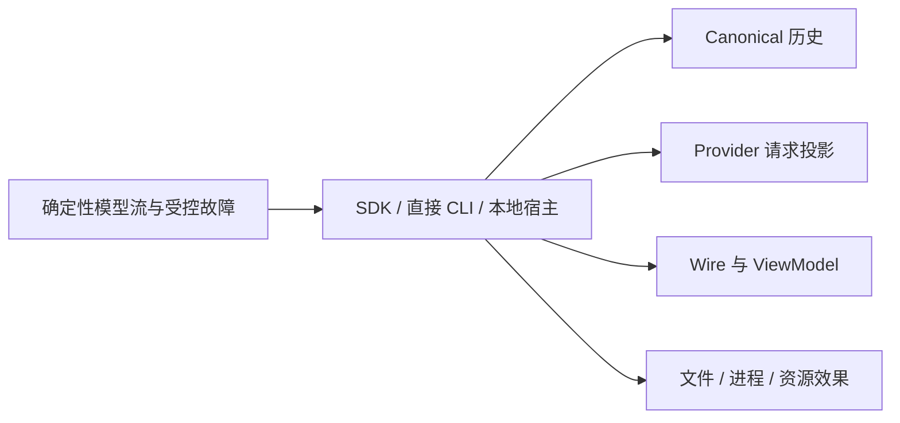

# Kapibala v0.0.10 技术方案：公共契约稳定与整合验收

日期：2026-10-21（Asia/Shanghai），状态更新于 2026-10-22。核心实现与本地门禁已落地，契约对齐和发布验收持续收口；跨平台专项、正式 release 长跑与版本发布尚未完成。本文保留原始设计基线与工作量估算，当前证据和未完成项以 [验收记录](../verification/v0.0.10.md) 为准，不能据此将 v0.0.10 标记为已发布。

**SDK 迁移提示：本版虽编号为 v0.0.10，仍包含删除全局单例导出、缺省并发归属变化、配置类型约束与客户端 cursor 返回行为调整。升级前必须检查 §4.2；“稳定整合”描述交付目标，不表示可无条件替换 v0.0.9。**

基线：工作区版本 0.0.9，调研提交 `76633e1c9ceba6c278f26c433e58cba04d2c03b2`。关联：[路线图](../RELEASES.md)、[架构基线](001-agent-framework-design.md)、[本地客户端契约](002-v0.0.9-local-client-contract.md)、[现役本地宿主说明](../local-host.md)、[v0.0.9 验收记录](../verification/v0.0.9.md)。本文为本版设计真源；实施计划和规格应引用本文，不复制另一份完整设计。

## 1. 版本定位与决策边界

用户已确定：沿用项目当前的整合方向；原规划 v0.1.0 的稳定整合调整为 **v0.0.10**，原规划 v0.1.1 的 Electron 桌面客户端调整为 **v0.1.0**。已发布的 v0.0.9 与历史验收记录不重命名。

版本采用三段稳定编号，minor/patch 允许多位非负整数且无前导零。默认仅增加 patch，`0.0.9 → 0.0.10 → 0.0.11`；`0.1.0` 等阶段版本由发布命令显式指定，不按十进制位进位。该编号决定不意味着本项目在 0.x 阶段承诺所有补丁升级均无 API 变化；本次已识别的 SDK 迁移必须按第 4 节明确列出。

本版目标是将既有能力收敛为可复用、可迁移、可验证的 Harness 基线，使桌面客户端能够复用稳定入口，而无需另行解释历史、工具、审批和取消语义。以下接口组织、测试预算及工期是工程决策，不代表已取得平台证据。

| 本版交付 | 后续独立规划 |
|---|---|
| Core 公共导出与声明基线、资源归属修正、结构化会话错误 | Electron/Web/移动客户端、全屏 TUI 和鼠标交互 |
| wire 1.0 响应、快照 DTO、运行时校验与跨版本兼容测试 | 新 RPC 能力、远程监听、跨连接事件重放、重启自动续跑 |
| 现役历史与配置迁移语料、权限与生命周期组合回归 | 新历史格式、任务内部压缩、新压缩算法、长期记忆 |
| 三平台与 Node 最低版本、产物、终端、MCP、资源门禁 | Worktree、跨进程工作区锁、审批冒泡、自动投递、任务树 Token 账本 |

保持 Core/CLI/MCP 三个发布包和既有依赖方向。Core 继续 Headless、零外部运行时依赖；协议与展示子路径保持浏览器可用，Node 客户端保持显式启动与无导入副作用。

## 2. v0.0.9 基线现状与本版处理

| 接点 | v0.0.9 基线行为 | 本版处理 |
|---|---|---|
| `packages/core/src/index.ts` | 以大量 `export *` 暴露入口 | 盘点实际发布面并记录签名，避免无意增加或删除导出 |
| `context/session/index.ts` | `workspaceRoot`/`rootDir` 均为可选类型，运行时要求至少提供其一 | 使用至少有一个根字段的联合类型；保留 rootDir-only 兼容输入及冲突校验 |
| `capabilities/security/lease.ts` | 导出全局 `sharedWorkspaceLeaseCoordinator` | 移除全局实例；会话缺省独占，宿主显式共享 |
| `cli/src/index.ts`、`subagent-runner.ts` | 直接 CLI 父子装配未统一注入协调器 | 同一 CLI 宿主创建并注入同一实例 |
| `local-host/resources.ts` | 工厂已显式创建宿主级协调器 | 保持该边界并加入跨装配验证 |
| `protocol/types.ts`、`schema.ts` | 请求与事件有类型/Schema，普通成功响应仍为 `JsonValue` | 增加响应目录、快照 DTO 和结果校验 |
| `client/local-client.ts` | 无 cursor 的快照自动重组；有 cursor 的分块也进入同一重组分支 | 区分首块、续块和客户端完整结果，修正续块误解析 |
| `local-host/registry.ts`、`snapshots.ts` | 快照元数据和分页形状位于宿主内部 | 纯数据类型收敛到 protocol，宿主实现继续留在原目录 |
| `context/session-lock.ts`、`session-manager.ts` | 部分状态以普通 Error/message 表达 | Core 产生稳定 code，wire 按 code 映射 |
| v0.0.9 验收 | 已有全量门禁及部分真实平台证据 | 补齐最低 Node、ACL、进程树、终端与资源验收 |

v0.0.9 的 145 个测试文件、1253 项测试通过来自已有记录，不作为本版通过证据。当前存在的能力也不等于其任意组合已经验证。

## 3. 开源参考与适配原则

以下证据来自 `/Users/kiturone/Documents/Project/aigc` 的本地快照。提交固定用于复查，不要求实施时追随上游 HEAD；没有复制参考项目实现。

| 项目 / 提交 | 源码入口（参考仓库相对路径） | 吸收方式 |
|---|---|---|
| Codex / `014489466a` | `codex-rs/app-server-protocol/src/schema_fixtures.rs`、`src/protocol/common.rs` | 为公开协议生成可审查的契约快照；后续扩展显式协商，不照搬其远程服务体系 |
| Pi / `73f8de80b` | `packages/coding-agent/docs/sdk.md`、`docs/session-format.md` | 明确存储真源、订阅及清理边界；SDK 示例进入类型和产物验证，继续使用 Kapibala 的显式工作区要求 |
| OpenCode / `acdcdb8dd9` | `packages/sdk/test/contract-identity.test.ts`、`request-retention.test.ts` | 测试权威契约一致性及请求释放；保留现有 TypeScript/Vitest，不引入 Effect/Bun 运行时 |
| DeepSeek Harness / `687f282e86` | `packages/test-support/llm-replay/`、`session-snapshot/`、`benchmarks/session-corpus/` | 用无密钥场景同时比较历史、模型输入、协议和副作用；在现有测试目录实现小型辅助层 |

Codex 的版本对应 Schema 生成与实验能力准入另见[官方 App Server 文档](https://developers.openai.com/codex/app-server/)。参考项目采用的状态名、阈值或迁移方式不自动成为本项目承诺；以下规则以 Kapibala 的历史闭合和宿主安全边界为准。

## 4. 公共 API 与兼容政策

### 4.1 公共面清单与基线

对 Core、MCP 根入口，以及 CLI 的 `protocol`、`client`、`view-model` 子路径生成公开导出清单与声明基线。记录导出名、导出种类、参数、返回值及引用类型；从独立声明产物检查，不只扫描源码中的 export 行。旧端声明只取自固定 v0.0.9 发布 tarball 的 dist；候选声明从当前源码输出到临时目录，二者分开保存，禁止用候选源码反向重建旧基线。

已实现 `scripts/check-public-api.ts` 与 `scripts/fixtures/public-api/`。旧端清单固定三包名、版本、来源 URL、registry integrity 与下载字节校验和，保留原始 package.json、tar 清单和声明；校验字节后才提取，fixture 中不得含用户凭证。候选预期差异另存，不覆盖旧输入。输出排序和换行规范化，不删除 overload、可选性、联合类型或泛型约束。检查过程只读；更新候选基线使用显式更新选项并经人工审阅，普通 CI 不写回。

所有已发布导出都纳入兼容盘点。文档可以描述推荐入口和高级用法，但不能通过重新标为“内部”来绕过删除审查。保留 CLI 已有 `./dist/*`：以旧 tarball 中实际匹配的文件为有限集合，将具体导入地址、格式、声明可达性与导出清单纳入 manifest；JS、声明、静态资源分别比较存在性和可访问性，不把通配模式本身当成“已枚举”。候选集合的增加/删除均显式报告，声明可用入口再比较签名；库入口在隔离进程检查导入副作用，可执行入口单独验证路径及 `--help`，不能在检查主进程直接 import bin 并强加库入口的无启动副作用要求。原始文件清单可保留 map 等构建资源，不因此将其列为推荐代码 API。本版不做整体 barrel 重构或增加新 npm 包。

### 4.2 根字段与迁移清单

保留 rootDir-only 输入，不将 `rootDir` 降为只读字段。`SessionConfig` 采用公共选项与根字段联合的交集，示意如下；`SessionOptions` 承载现有非根字段，新旧根都给出时由运行时校验同一物理路径：

```ts
type SessionConfig = SessionOptions & (
  | { workspaceRoot: string; rootDir?: string }
  | { workspaceRoot?: never; rootDir: string }
);
```

只传绝对 rootDir、只传绝对 workspaceRoot、两者指向同一物理目录均继续有效；两者都缺失在类型层拒绝，JS 绕过类型仍抛 `WORKSPACE_ROOT_REQUIRED`。两者冲突或非绝对路径仍抛 `CONFIG_INVALID`，不静默选择一个。`resolveWorkspaceContext` 的宽输入接口保留，以便处理 unknown/旧式配置和测试运行时失败。Session 的只读 `workspaceRoot/rootDir` 输出保持规范化派生语义。

`SessionConfig` 从 interface 变为联合 type 会影响 `interface X extends SessionConfig`、`class X implements SessionConfig` 和模块声明合并。这些用法必须列入迁移：使用交集类型表达扩展配置，或对新增的非根选项接口 `SessionOptions` 扩展后再与根联合相交；不隐瞒接口种类变化。

| 变化 | 影响 | 迁移方式 |
|---|---|---|
| SessionConfig 至少提供一个根字段，interface 改为联合 type | 缺少两字段的调用、接口继承/合并用法需要调整；rootDir-only 保持有效 | 优先 workspaceRoot；兼容 rootDir；扩展配置改用交集或 SessionOptions |
| 删除 `sharedWorkspaceLeaseCoordinator` 导出 | 导入旧单例的 SDK 代码需要调整 | 显式创建 `WorkspaceLeaseCoordinator` 并注入需要共享的会话 |
| 缺省协调器改为会话独占 | 独立 SDK 会话不再暗含全局串行关系 | 同一业务宿主持有并注入共享实例，见第 5 节 |
| `LocalClient.call()` 结果具体化 | 依赖宽泛结果进行不安全索引的调用可能需收窄类型 | 使用方法结果类型；cursor 快照按分块结果处理 |
| 显式 cursor 从误重组分支改为原始续块返回 | 运行时返回形状/失败路径变化，不能仅称为类型收窄 | 读取正文用无 cursor 调用；手动分页处理 chunk/cursor，见 §6.3 |
| attach 中途取消、重组或缓冲回放失败明确拒绝并关闭整个连接 | 同一连接的其他控制会话也会断线收口；不再允许异步 close 后仍返回快照 | 新建连接后按需重新 attach，不重发写任务；独立控制需求使用独立连接 |
| SpawnContext 必须携带协调器，runner 接收第三个运行上下文；CLI runner 工厂协调器必填 | 自定义 prepareSpawn/runner 装配及 CLI 工厂调用需更新 | 注入父 Session 实际实例，消费 runner 上下文，不序列化该实例 |
| LocalTransport 增加必填 `setLimits(limits: TransportLimits): void` | 自定义传输实现需支持握手后收紧帧与发送队列预算 | 导入公开 TransportLimits，修改实现；缺少能力时连接失败，不静默使用默认值 |
| 清理异常改用类型化 code | 部分原先退化为 INTERNAL_ERROR 的清理失败会细化到既有 SESSION_CLEANUP_FAILED | 调用方按既有业务码处理可重试关闭，不将取消请求失败理解为任务已停止 |

上述变化分别覆盖类型/接口种类、导入、并发、客户端运行时及 runner 装配，不能合称“完全兼容”。其余公共签名原则上保留；发现新增破坏点时先记录影响及迁移，再决定是否纳入，不能借整合任意删除功能。`sdk-compatibility`、迁移说明与发布说明均须在开头突出此表，不能仅在文末说明 0.x 编号政策。

新增与修改的导出、重要公开方法和易误解字段同步维护简体中文 JSDoc，说明约束、失败边界与调用责任。示例覆盖最小会话、共享租约、受控取消和本地客户端；现有 `examples/**/*` 已进入类型检查，本版补上安装产物执行。

## 5. 写租约与资源所有权

### 5.1 创建与共享

`AgentSession` 未收到 `leaseCoordinator` 时创建会话持有实例；不得在模块顶层创建协调器，也不得通过静态属性、服务定位器或隐藏缓存恢复全局共享。

| 所有者 | 创建位置与存续期 | 共享范围 |
|---|---|---|
| 独立 SDK Session | 构造会话时；随会话持有 | 缺省仅自身 |
| 直接 CLI 宿主 | 创建运行时及会话工厂之前 | 本宿主创建的根会话、切换会话与所有后代 |
| daemon 资源工厂 | `createResourceFactory()` 调用内 | 该工厂装配的 Session 与子代理 |
| SDK 自建宿主 | 由调用者显式创建和管理 | 调用者指定的相关会话 |

修改范围必须包含 `cli/src/index.ts`、`subagent-runner.ts`、`local-host/resources.ts`、Core Session/lease、executor/tool context、agent tools/runtime 和示例。父协调器沿以下内存路径传递，不能仅由自定义 runner 阅读文档后自行猜测：

1. Session 将实际协调器交给 ToolExecutor；执行上下文提供只读引用，`spawn_agent` 从该宿主字段取值，不接受模型参数提供实例。
2. `SpawnContext.leaseCoordinator` 必填，`prepareSpawn` 运行时也检查缺失；缺失在受理、持久副作用和启动子会话之前以 `CONFIG_INVALID` 失败。通用 ToolContext 可保留可选字段以兼容其他工具，但 spawn 入口必须收窄。
3. Runtime 按 agentId 在内存表保存该引用，调用 `SubagentSessionRunner(record, signal, context)` 时提供必填的 `context.leaseCoordinator`。它不进入 AgentTaskRecord、outbox、模型请求或 wire；rollback、任务清理完成或关闭后释放引用，后代仍通过自己的 spawn 上下文传递。
4. `CliSubagentRunnerOptions.leaseCoordinator` 改为必填，工厂缺参在创建 Store 前失败；执行时与第三参数的实例做身份核对，不一致以 `CONFIG_INVALID` 失败。创建子 Session 使用已核对实例，父 CLI/daemon 装配传入同一宿主实例。

SDK 自定义 runner 通过第三参数取得实际父协调器并注入子 Session；旧二参数回调在 TypeScript 中仍可能结构兼容，但忽略新参数不会自动共享。库不能证明任意自定义回调内部遵守约定，因此还须提供可编译的共享示例、缺失 SpawnContext/CLI 工厂参数的编译失败用例，以及绕过类型时零副作用拒绝的运行测试。

租约按既有 native 物理工作区根分桶，Windows 身份比较继续复用现有大小写规则。写操作分类、FIFO 排队、取消与 finally 释放沿用现有执行器；不增加另一套文件锁。外部 MCP 未明确只读的调用继续进入写租约。

跨进程不同 conversation 仍无工作区写互斥，同一 conversation 的存储锁继续生效。协调器不是 OS 级 Shell 沙箱，也不能阻止自定义工具绕过其声明边界。

### 5.2 验证

至少用真实 Session/宿主装配验证：同工作区父子写操作不重叠、异工作区可并行、排队取消后后继可运行、失败和提前结束迭代后释放租约。两个独立宿主实例不共享协调器；该断言只证明生命周期隔离，不宣称允许它们并发写同一项目。

另加负面用例：两个独立 SDK Session 漏传共享实例时，各自执行器收到不同协调器，不能暗示自动互斥；spawn 链路漏传引用、CLI 工厂缺参和实例不一致必须在分配子 Store/执行工具前失败。测试使用屏障观察两个写操作是否重叠，避免依赖固定 sleep；任意忽略上下文的自定义 runner 的风险在示例中明确，不由进程全局回退掩盖。

## 6. wire 响应与快照契约

### 6.1 类型和校验的归属

protocol 保持纯 JSON，无 Node/Core 运行时依赖。响应类型、结果 Schema、快照元数据、公开历史与分块类型归此入口；`SnapshotPager`、Registry、凭证脱敏和字节处理仍属于宿主/transport。

保留公开手写类型的可读性；Schema 使用保留字面量的泛型构造函数，增加类型层面的 Schema 推导与双向等价断言。请求方法与结果选择器按 WireMethod 全覆盖，事件 payload 目录单独按事件名全覆盖；方法集合不要求与事件名集合相同。不允许缺项或以 `any`/强制断言绕过。仅按响应需要扩展现有子集的 null、联合分支和字面量能力，不引入新的校验库或无限制 JSON Schema 引擎。

响应采用 request-aware 校验：按完整原请求的 method/params 选择结果变体。`session/snapshot` 在本地契约表内有 `snapshot:first` 与 `snapshot:page` 两个变体键；它们不增加 wire method。类型结果映射和运行时 validator 共用同一表及 selector，不能分别手写有无 cursor 的分支。RpcPeer 的 pending 条目保存已验证的原请求或不可变 method/params 描述，接收响应时先按 id 关联，再按原请求选择 Schema；不能只存 method、不能让响应内容反过来决定用哪个 Schema。

| 原请求 | 选择的结果变体 | 必须拒绝 |
|---|---|---|
| `session/attach` | `snapshot:first` | 缺元数据的 page |
| `session/snapshot` 且 cursor 未提供 | `snapshot:first` | 缺元数据的 page |
| `session/snapshot` 且 cursor 已提供 | `snapshot:page` | 带首块元数据的响应或伪完整 body |
| 其余方法 | 对应单一方法结果 | 其他方法/变体的结构 |

请求 Schema 已拒绝空 cursor；selector 按字段是否提供判定，而非接收结果是否恰好有 chunk。公开泛型类型允许首块/续块联合，但执行某一请求时只接受其确定变体。JSON-RPC 响应外壳的通用校验与本层方法结果校验分开，所有成功结果必须经过后者后才 settle pending。

生成协议契约快照时覆盖类型、Schema、错误码、能力和预算；与固定旧基线比较。类型检查解决结构漂移，行为测试另行覆盖数值预算、跨字段身份及权限约束。

### 6.2 方法成功结果

以下是现有 wire 1.0 形状的稳定化，不据此新增字段或改变请求方法：

| 方法 | 成功结果 |
|---|---|
| `initialize` | `major`、`minor`、`capabilities`、`serverInstanceId`、`clientId`、`limits` |
| `ping` | `{ alive: true, serverInstanceId }` |
| `session/create` / `session/open` | `{ sessionId, conversationId }` |
| `session/list` | `{ items: [{ conversationId, title }], cursor: string \| null }` |
| `session/attach` | 快照元数据与首块 `{ chunk, cursor }` |
| `session/snapshot` 无 cursor | 快照元数据与首块 `{ chunk, cursor }` |
| `session/snapshot` 有 cursor | 仅 `{ chunk, cursor }` |
| `session/detach` / `session/close` | `{ detached: true }` / `{ closed: true }` |
| `run/start` | `{ runId, accepted: true }` |
| `run/cancel` | `{ cancellationRequested: true }` |
| `approval/request` 的客户端回复 | `{ choice }`，沿用五选一 |
| `host/shutdown` | `{ stopped: true }` |

初始化 limits 的每个现有字段都必须校验，不能仅校验客户端当前使用的四个关键预算。保留服务端不得放大客户端硬上限的约束。已存在的角色、控制权和阶段校验继续由服务端执行；类型不是授权凭证。

初始化成功后保存独立冻结的 `negotiatedLimits`，连接生命周期内不从 DEFAULT_LIMITS 重新读取运行预算。握手前使用本地 bootstrap 上限；初始化响应必须包含全部已知正整数预算，任一字段超过本地硬上限都以 PROTOCOL_MISMATCH 拒绝，不对放大值静默取较小值。通过校验后直接采用并保存服务端值；客户端消费点必须实际执行收紧后的预算，服务端配额仅用于展示和诊断。

| 客户端消费点 | 采用的预算 |
|---|---|
| 快照总重组、attach 事件缓冲 | `negotiatedLimits.maxSnapshotBytes`；缓冲使用增量字节计数，入队前计入新事件，不能先超额再检查 |
| RpcPeer 发起/接收的在途请求 | `negotiatedLimits.maxInflightRequests` |
| 内置 transport 分帧与发送队列 | `negotiatedLimits.maxFrameBytes/maxSendQueueBytes`，握手后只收紧，已有排队量超额则失败关闭 |
| 审批本地等待 | `negotiatedLimits.approvalTimeoutMs` 与 expiresAt 所允许的较短期限 |
| 客户端待审批回调表 | 每会话按 `negotiatedLimits.maxPendingApprovals` 检查，超额失败且不分配回调 |
| 会话/运行/操作 ID 等服务端配额 | 保留公布值用于展示和诊断；最终由宿主统一裁决，客户端不凭局部计数冒充全局剩余量 |

预算在连接和 RpcPeer 间通过同一内部预算持有者传播，握手完成前不得发起业务请求。LocalTransport 增加必填同步方法 `setLimits(limits: TransportLimits): void`，TransportLimits 仅包含只读的 maxFrameBytes/maxSendQueueBytes，从 client 子路径一并导出；握手前传输仍用本地硬上限，握手成功时向其传入已验证且不大于本地硬上限的服务端值。该方法只能维持或收紧，若现存解码缓冲/发送队列超额则抛错并关闭连接；内置 stdio/socket 与测试传输都实现此方法。自定义传输缺失方法时 LocalClient.connect 明确以本地 `PROTOCOL_MISMATCH` 拒绝，不能静默保留默认值；此公共签名变化列入 §4.2。数值虽合法但不足以容纳后续业务时按上限失败，不因小预算自动放宽。

initializationTimeoutMs 属于握手前的 bootstrap 截止时间；收到响应时仍完整校验并保存，但不追溯已经完成的初始化，也不把业务 RPC 的 30 秒缺省超时误当成该字段。全部握手后内存/队列消费点按上表收紧，服务端配额与初始化专用字段明确分开。

### 6.3 快照三种形态

已公开 `SnapshotMetadata`、`SnapshotPage`、`SnapshotBody`、`WireSnapshot` 和 `ClientSnapshot`，各形态的语义固定如下：

| 类型 | 约束 |
|---|---|
| 元数据 | 现有 session/stream/control 身份、instance、`seq`、conversation、nullable runId、pendingApprovals、会话配额 |
| 首块 wire 响应 | 元数据 + chunk + nullable cursor，尚未承诺完整正文 |
| 续块 wire 响应 | 只有 chunk 与 nullable cursor，不能假装含元数据 |
| 逻辑正文 | `{ history, live }`；history 为现有公开消息，live 为完整 WireEvent 列表 |
| 客户端完整结果 | 首块元数据 + 已验证的 history/live；保留现有 `chunk: ''`、`cursor: null` 返回字段 |

注意 `seq` 在空快照可以为 0，WireEvent 的 seq 从 1 开始；观察者的 `controlEpoch` 可为空字符串，不能套用非空控制 ID Schema。公开消息只定义目前实际投影的 `id/role/state/blocks`，块包含 `kind/text`；不在本版补发 Provider 私有内容、原始工具参数或新消息身份。

`LocalClient.call()` 使用客户端结果映射；`session/attach` 和不带 cursor 的 snapshot 自动收集、校验并返回完整结果。显式提供 cursor 的调用只返回续块，不自动解析残缺 JSON；参数含可选 cursor 的泛型调用返回对应联合，不能向调用者保证单一形态。底层 RpcPeer 按 wire 结果校验，职责与自动重组分开。

这一调整是运行时行为迁移。v0.0.9 显式 cursor 会误入自动重组：offset=0 游标可能碰巧重建正文；正常非零偏移续块缺少 JSON 前缀，通常会解析失败并关闭连接，不能描述成旧版稳定提供完整 body。新端始终返回原始 page，示意如下：

```ts
// 获取完整正文：旧端可用的无 cursor 路径继续保留。
const snapshot = await client.call('session/snapshot', { sessionId });
snapshot.history;

// 显式 cursor：新端仅返回这一续块，不再自动补全或解析正文。
const page = await client.call('session/snapshot', { sessionId, cursor });
page.chunk;
page.cursor;
```

按 cursor 存在性提供 overload：无 cursor 返回 ClientSnapshot，有必填 cursor 返回 SnapshotPage，cursor 可选的变量返回联合。类型测试拒绝直接读取 `page.history`。跨版本测试区分“新客户端/旧宿主仍能分页”和“旧客户端/新宿主仍保留旧客户端误重组缺陷”；后者记录为旧客户端已知限制，不以改动新宿主 wire 形状来伪装修复旧 SDK。

首块身份、水位、续块形状、重复游标、预算、JSON 正文结构及 live 中的 WireEvent 全部验证成功后才安装结果。attach 期间先缓冲事件，完整快照安装后仅应用同 instance/session/streamEpoch 且 seq 大于水位的连续事件。裸 snapshot 读取不授予新控制权，也不被当作旧连接缺号后的隐式恢复入口；缺号仍显式重新 attach。

恢复单位明确为整个连接，沿用当前 applyEvent 的关闭边界：一个已附着会话出现真正序号缺口，即令该 LocalClient 上所有会话失效，关闭传输、拒绝全部 pending、取消审批回调。上层创建新连接、重新初始化，再为需要的会话显式 attach；不在已关闭连接重试，不自动重发 run/start。其他控制会话也会受到断线清理影响，客户端文档必须说明；重复 seq 仍忽略，旧 instance/stream 的迟到事件不当作新流缺口。

attach 从发起到成功返回为一个客户端安装事务：收集快照及增量缓冲后，先验证缓冲序列并在同一同步发布段安装水位/投递连续事件；不得逐条先发布，再发现后续缺号。读取回调发现错误时同步标记连接失败和 attach 失败，拒绝 pending，再安排 transport 关闭，避免读取回调等待自身 done。call 在每个 await 返回后和最终 resolve 前复核连接代际、失败标记与 signal；缓冲回放失败必须抛错，不能只 `void close()` 后继续返回快照。

attach 中途取消或任何重组失败均丢弃缓冲、页数据与临时水位；为收回服务端可能已授予的控制权，关闭整个连接并交给服务端 disconnect 清理。该 close 不能等待自己所在的读取任务造成死锁。完整校验和同步安装之前不向订阅者发布临时正文；成功返回以后发生的新断线按正常连接失败处理，不承诺永久有效的快照。

### 6.4 演进与跨版本矩阵

产品 0.0.10、wire 1.0、历史 schema v2 各自独立。本版维持现有字段、方法、错误形状、能力与预算。由于 v1.0 接收方严格拒绝未知字段/事件，“新增可选字段”本身不构成旧端兼容；未来扩展必须由版本或能力协商后选择发送形状。

固定 v0.0.9 发布的三个 tarball、来源与校验和作为旧端，与 §4.1 共用同一来源 manifest；候选构建为新端，禁止浮动 latest。覆盖旧→旧、旧客户端→新宿主、新客户端→旧宿主、新→新四种组合。真实 stdio 和平台 socket/pipe 验证初始化、列表、打开、attach、运行、审批、取消和关闭；协议错误、未知能力/事件及游标过期另有拒绝用例。显式 cursor 用 §6.3 的版本相关预期单独验证，四组合“兼容”不表示旧客户端自身缺陷会消失。安装旧端的网络准备与无网络回归执行分开，缓存缺失明确失败。

## 7. 错误与生命周期语义

### 7.1 稳定错误目录与映射

以下为 P0 采用的最小目录：Core 在源头产生 `KapibalaError.code`，CLI 配置/清理边界产生本地宿主类型化错误；不把 CLI 配置概念移入 Core。加锁和释放锁的上下文由调用边界传入，不通过 message 猜测。

| 层 / code | 场景 | wire 1.0 data.code |
|---|---|---|
| Core `SESSION_BUSY`（沿用） | 同会话已有运行，不能开始变更 | `SESSION_BUSY` |
| Core `SESSION_LOCKED`（新增） | 会话被存活或未知持有者占用 | `SESSION_BUSY` |
| Core `SESSION_RECOVERY_IN_PROGRESS`（新增） | 另一持有者正在恢复锁 | `SESSION_BUSY` |
| Core `SESSION_LOCK_OWNER_CHANGED`（新增） | 加锁竞争期间 owner 变化 | `SESSION_BUSY` |
| Core `SESSION_LOCK_OWNER_CHANGED` | 释放锁时 owner 已变化 | 宿主清理边界包装为 `SESSION_CLEANUP_FAILED`，保留内部 cause |
| Core `SESSION_NOT_FOUND`（源头结构化） | 会话缺失或非法查找身份 | `SESSION_NOT_FOUND` |
| Core `SESSION_ID_AMBIGUOUS`（新增） | 短前缀匹配多个会话 | `SESSION_NOT_FOUND` |
| Core `HISTORY_PAGE_INVALID`（新增） | 非法历史页 | `INVALID_PARAMS` |
| Core `WORKSPACE_ROOT_REQUIRED`（沿用） | 两个显式根都缺失 | `WORKSPACE_ROOT_REQUIRED` |
| Core `CONFIG_INVALID` / `WORKSPACE_ESCAPE`（沿用） | RPC 输入路径、别名冲突或执行目录越界 | `INVALID_PARAMS`，不增加 wire 分类 |
| Host `CONFIG_REQUIRED` | 配置文件、模型或密钥不可用，包括配置读取阶段的 CONFIG_INVALID | `CONFIG_REQUIRED` |
| Host `TRUST_REQUIRED` / `MCP_CONFIG_INVALID` | 项目信任/MCP 配置未满足 | 同名既有 wire code |
| Host `SESSION_CLEANUP_FAILED` | runtime、Session、MCP 或句柄释放未完成 | `SESSION_CLEANUP_FAILED` |
| Host `RUN_NOT_FOUND` | 取消目标不是当前活动 run | `RUN_NOT_FOUND` |

表中“新增”指计划实施的 Core code，不是新增 wire code；不一次性重命名全部领域错误。权限/配置和清理边界保持原语义，只把可识别原因结构化；其他现有宿主控制错误继续使用既有白名单。映射优先级为：已知类型化 code + 明确操作上下文 → 已有宿主错误分类 → 少量旧异常前缀兜底 → INTERNAL_ERROR。`normalizeSessionError` 同步改为 code-first，不能换个位置继续主用 startsWith。

保留现有人类可读消息作为迁移缓冲；未知错误即使自带任意 code/message 也不能直接放行到 wire。测试用同一 code 配不同内部消息证明分类稳定，用未知 code 和敏感原文证明仍折叠；权限、凭证、输入、PID、路径和堆栈不能通过错误穿透。

### 7.2 取消与资源完成的边界

| 观察点 | 可以证明 | 不能推断 |
|---|---|---|
| `run/start` 返回 accepted | 操作 ID 已受理并关联 runId | 任务成功或工具已经执行 |
| `run/cancel` 成功返回 | 接受瞬间目标等于 active.id，已请求 abort，且本次 `cancelChildren()` 调用成功完成 | 父 `active.done` 已结束或存储句柄已释放；前者继续等待 settled/状态，后者等待 close |
| Core `run_finish` | 运行结果已形成 | finally、插件清理或存储锁已释放 |
| wire `run_settled` | 宿主已结束此次迭代并给出 outcome | 整个会话已销毁；清理失败已被修复 |
| `session/close` 成功 | 容器释放成功，句柄已回收 | 历史被删除 |
| `host/shutdown` 成功 | 所有受管资源已完成关闭 | 任意不受管进程都已被回收 |

不新增一套 Core 生命周期状态机。保留 `activeRun`、宿主 active、`needsCleanup`、closing/disposal 等现有机制并补组合测试。取消和自然完成竞争保留真实完成结果；工具 use 一旦落盘，其结果必须闭合落盘后才能释放运行锁。消费者 return/break 同样等待在途清理。

run/cancel 保持当前在途幂等语义，不新增已结束 run 的终态缓存或“结束也成功”的行为：

| 校验时状态 | 结果 |
|---|---|
| 未知 runId，或旧 runId 与新 active.id 不同 | `RUN_NOT_FOUND`，不取消新任务 |
| 同一 run 仍活动，首次或重复取消 | 请求 abort，等待本次子任务取消调用；成功返回 cancellationRequested |
| 父工具/取消清理仍在进行，active.id 仍匹配 | 与在途取消相同；子任务清理失败则返回 SESSION_CLEANUP_FAILED，并保留围栏 |
| 已自然完成，active 已清除 | `RUN_NOT_FOUND` |
| 已取消结束，active 已清除 | `RUN_NOT_FOUND` |
| active 已清除但 needsCleanup 为 true | `RUN_NOT_FOUND`；继续用 close/shutdown 清理，不能靠重复取消解除围栏 |

控制权和 epoch 校验仍先于 runId，因此上述结果以调用者拥有有效控制权为前提。若 run 在接受取消后才自然结束，本次成功响应仍有效，最终 outcome 保留真实完成状态；若调用到达时 active 已清除则失败。这一时序由屏障测试固定，不向客户端承诺跨终态幂等。客户端收到 RUN_NOT_FOUND 后可查询状态/显式快照，不盲重试写任务。

运行结束但 Core 仍忙、MCP teardown 失败或 Session 清理失败时保留句柄和存储锁，拒绝新运行，允许 close/shutdown 重试。控制身份的撤销或重新获取不等于解除 cleanup 围栏。disconnect/shutdown 对子任务清理异常也必须记录失败并保持可重试状态，不能仅因父迭代结束便假报干净退出。

## 8. 历史与配置迁移语料

### 8.1 历史

保持 schema v2。v1 只读，升级生成新副本；旧原文、已确认结果和源身份不能被测试 normalizer 擦掉。`packages/core/tests/fixtures/compat/` 已保存基础兼容语料；以下为完整覆盖目标，各项是否已有专用语料或由既有回归覆盖，以验收记录为准：

| 语料 | 验证 |
|---|---|
| v1 正常/损坏尾部 | 原文件哈希不变；合法 v2 副本；损坏明确诊断 |
| v2 分支、fork、归档 | 因果链、活动分支、来源和导入不重复计费 |
| 半工具事务、失败尾部、连续同角色 | canonical 规范化合法，未知结果标记，不执行旧工具 |
| 裁剪/摘要检查点及持久化失败 | 先提交后激活；失败不生效，重启投影一致 |
| 三 Provider 私有状态 | 模型投影合法，公开历史出口剥离私有字段 |
| Skill/MCP 来源 | 可追踪来源；不恢复旧审批或失效目录权限 |
| 父子任务 outbox/inbox | 重复恢复/collect 不重复注入；来源分支不串用 |
| 未知 schema、身份冲突 | 明确拒绝，零工具执行、零原文覆写 |

每个语料记录来源版本、预期成功或失败、源哈希、目标结果和副作用次数。迁移中断/写入失败后不得留下可被误认为完整升级的副本；重复打开遵循现有升级身份机制。只承诺新端读取受支持旧格式，不承诺旧端读取新端所有写出内容。

### 8.2 配置

CLI 语料覆盖：同厂商密钥更新与同组冗余清理、unknown 网关 host 隔离、legacy ID 重定向、defaultModel/modelRouting 引用、文件缺失与损坏，以及只修改一项时不物化内置 profile。读取/写入继续使用 `resolveApiKeyDetailed`、`updateProfileApiKey`、`loadGlobalSettingsForWrite` 等现有真源，不复制推断逻辑。

本版无模型目录换代需求，不因新增语料提升 `BUILTIN_CATALOG_VERSION`。配置损坏时写操作失败，旧文件不受损；环境凭证不被测试或迁移写回。活动 daemon 会话仍冻结配置，关闭再打开后重载。

## 9. 无密钥组合回归

扩展现有 Vitest/mock，增加测试专用脚本 Provider 和本地 HTTP 模型 fixture，不发布 replay 插件或测试 npm 包。场景定义包含模型分片、工具输入输出、取消/失败注入点、权限决策及预期工作区。工具和进程生命周期使用真实实现，外部模型服务才由确定性输入替代。



首批至少 12 类：正常工具事务、多工具部分失败、执行取消、消费者提前 return、审批拒绝/超时/断线、崩溃恢复、子代理取消/collect、技能权限收紧、MCP 撤销/teardown、压缩失败、慢客户端/大快照、操作 ID 去重/跨增量凭证脱敏。分别比较历史、模型可见请求、公开展示和文件/进程效果，不能用模型自述判断成功。

三个宿主复用适用的输入与副作用预期；三 Provider 用本地 HTTP 覆盖 Chat Completions、Anthropic Messages、OpenAI Responses 的实际解析与请求投影。平台、宿主、Provider 不做完整笛卡尔积；会话不变量在 Core 跑全量，协议四组合与 OS 专项在边界层跑，各专项在验收表注明覆盖面。

只规范化随机 ID、时间与临时根路径，并保持类型化身份关联；不删除事件顺序、parentId、工具参数差异、错误分类、授权结果或被测敏感内容的缺失/替换断言。fixture 更新必须显式执行和人工审阅，普通 CI 只比较。故障脚本必须消费完全，不能静默少跑一步仍通过。

真实模型小样本质量验收单独列出模型、输入、费用上限和限制，不作为无密钥 CI 前置，也不能代替协议和副作用断言。

## 10. 平台、产物与资源门禁

### 10.1 平台与运行版本

维持既有 Node `>=20` 和 Windows/macOS/Linux 支持目标。最低版本缺证据是发布阻断项，不能只改文案取消承诺。常规 CI 建议覆盖三 OS 的 Node 22/24；构建工具链可固定 Node 24，Node 20 通道必须由 Node 20 实际安装并运行打包产物。安装步骤与后续运行的 Node 版本均记录。

| 专项 | 必需证据 |
|---|---|
| Windows 本地传输 | 当前用户正常握手；不同用户不能访问私有运行凭证/元数据；获得端点后仍不能绕过 pipe 访问和协议认证 |
| Windows 执行与终端 | Git Bash/PowerShell 子进程树取消和退出；ConPTY 分片、粘贴、审批输入与异常恢复 |
| macOS/Linux | 真实 daemon/stdio/socket 生命周期；PTY 交互、取消与终端恢复 |
| MCP | 本地 Stdio 与 HTTP 测试服务，覆盖启动授权、调用授权、撤销、取消、关闭和失败重试 |
| Node 20 | 三包隔离安装、Core/MCP SDK、CLI、daemon/connect 及子路径导入 |
| 发布产物 | 无 workspace 链接的安装、精确依赖、Core 零依赖、Core/MCP ESM+CJS、CLI ESM、声明及 browser 子路径边界 |

ACL 与 ConPTY 环境在开发第一阶段预检；需要第二用户/独立 VM 的项目使用准备好的专用验收机，不能以“CI 无权限”跳过后仍标绿。真实验收与模拟测试分别记录。

### 10.2 有界资源与稳定性

沿用 `protocol/version.ts` 真源：帧 1MiB、初始化 5 秒、16 连接、64 在途请求/连接、8 打开会话、4 同时运行、128 pending approval/会话、120 秒审批、8MiB 快照/连接、4MiB 发送队列、1024 操作 ID/会话。测试不能在不同脚本另写宽松默认值。快照正文的 UTF-8 字节预算、64Ki UTF-16 块与传输二次 JSON 编码分别计量。

PR 仅执行 10 轮确定性生命周期 smoke，按资源类别断言 pending、订阅、timer、子进程和端点释放；完整 100 轮混合 open/run/cancel/close 放入 nightly，1000 轮放入 release soak。三档复用场景驱动，不通过降低断言强度区分档位。容量边界用例不靠循环碰撞，仍在每次 PR 覆盖少一项/等于/多一项；字节预算使用中文、emoji、转义和跨分片秘密等实际编码输入。操作 ID 满后旧 ID 可复用、新 ID 拒绝，关闭重开后旧代际拒绝。

发布前执行至少 1000 轮且持续至少 30 分钟的混合负载。首轮在固定 OS/Node/硬件上取得三次无并行构建的基线，记录预热、采样、回收等待和 GC 条件，再冻结可重现阈值。观察 RSS/heap 稳态趋势与句柄/对象界限；单次 RSS 波动不作为泄漏结论，增长无法解释则阻断。性能门槛只能在测量后补入验收记录，不能由本设计虚构毫秒保证。

## 11. 工程落点与验证编排

| 目录或入口 | 调整 |
|---|---|
| `packages/core/src/context/session/`、`capabilities/security/lease.ts` | 至少一个显式根字段的兼容联合、租约归属、中文注释 |
| `packages/core/src/errors/`、会话锁与管理器 | 稳定错误 code 与兼容消息 |
| `packages/cli/src/index.ts`、`subagent-runner.ts` | 父子装配显式共享协调器 |
| `packages/cli/src/protocol/` | 响应/快照类型、Schema、校验、类型等价断言 |
| `packages/core/src/runtime/agent/`、executor/tool context | 传递父协调器，内存 runner 上下文与零副作用拒绝 |
| `packages/cli/src/client/`、`transport/` | request-aware 结果校验、分块/重组、连接级失败、协商预算与 setLimits |
| `packages/cli/src/local-host/` | 复用公共 DTO、输出验证与生命周期边界 |
| `packages/*/tests/`、`examples/` | 迁移语料、组合场景、SDK 示例 |
| `scripts/check-public-api.ts`、`check-protocol-contract.ts` | 声明与协议基线，只读门禁/显式更新 |
| `scripts/` 中平台、打包辅助 | 提取版本无关 helpers，旧版本入口保留薄封装 |
| `.github/workflows/verify.yml` | 平台/Node 与独立产物通道；release 复用相同源提交的门禁 |

`pnpm verify` 继续 typecheck → test → lint，密钥扫描与架构门禁不退化，`--verify-only` 与其同源。类型等价断言纳入 typecheck，确定性组合回归纳入 test，API/协议快照检查纳入 lint。声明基线子命令必须自行从当前源码生成所需声明到独立临时目录，再执行比较并清理；不读取可能陈旧的 dist，也不要求使用者预先运行 build。检查失败保持原基线不变，普通校验不自动更新基线，干净检出和 verify-only 均能走同一流程。

已实现专项入口 `pnpm verify:compat`（固定旧新产物）、`pnpm verify:platform`（当前 OS 能执行的真实进程项目）、`pnpm verify:soak`（按 nightly/release 档执行长时资源验收）。当前执行范围与 pending 项见验收记录，命令存在不等于专项已经通过。`pnpm build` 后执行隔离打包安装，正式发布工作流必须依赖最低运行版本和必需平台通道；人工专项由与候选提交一致、可复核的验收记录承接，不把 workflow 绿等同于人工项完成。PR 必跑 10 轮 smoke，nightly 必跑 100 轮，发布候选必须持有相同提交的 release soak 报告，不能拿其他提交的 nightly 替代。

## 12. 实施阶段、独立阻断项与验证矩阵

### 12.1 阶段与工作量

以下保留方案形成时的原始估算，不代表当前剩余工期；已实现内容和剩余验收工作以验收记录为准。

| 阶段 / 估算 | 任务 | 阶段出口 |
|---|---|---|
| P0 / 3–5 人日 | T01 固定旧 tarball/声明及候选差异格式；T02 登记下表平台阻断项并做可用性预检 | 旧端基线可复查；契约和最小用例定稿；环境缺失有明确记录 |
| P1 / 6–8 人日 | T03 根字段/公共 API；T04 租约与 runner 装配；T05 request-aware 快照、limits/连接失败；T06 错误与取消 | 迁移清单完整，定向测试通过 |
| P2 / 6–9 人日 | T07 四组合兼容及旧端缺陷预期；T08 历史/配置语料；T09 无密钥组合场景 | 旧数据、旧端和现有能力连续运行 |
| P3 / 6–10 人日 | T10 三平台/产物；T11 nightly/release 资源边界与长时验收 | 独立阻断项目均有候选提交对应证据 |
| P4 / 3–4 人日 | T12 迁移警示、SDK/协议/发布文档与预演 | 发布候选可供用户审核 |

实现与验收工作量合计 24–36 人日；加约 20% 缓冲约 29–43 人日，按单人全职约 6–9 周估算。环境开通、第二用户/VM 准备和人工终端验收的等待时间另记，不能被该人日估算隐含吞掉，也不能由本文件假定已有执行资源。平台预检从 P0 开始，与后续编码并行；缺环境不必阻止不依赖它的实现，但对应发布阻断不能解除。

每个行为修改先用对应失败用例证明问题，再实现；一次通过后仅在变更或新问题出现时复跑相应检查。方案阶段不批量实现功能，也不把空任务勾选为完成。

### 12.2 独立平台证据阻断项

| 编号 | P0 必须登记 | 发布前必须取得 |
|---|---|---|
| G-N20 | 可用 Node 20 安装/运行环境、执行者和缺口 | 候选 tarball 安装与实际 Node 20 进程报告 |
| G-ACL | Windows 第二用户或等价隔离 VM 的可用性 | 私有凭证/元数据、pipe 与认证的不同用户拒绝证据 |
| G-PTY | Windows ConPTY、macOS/Linux PTY 的实际终端环境 | 分片/粘贴/审批/取消/异常恢复的人工或自动报告 |
| G-TREE | Windows Git Bash/PowerShell 与 POSIX 进程树环境 | 取消及关闭后受管后代退出，失败不误报清理完成 |
| G-MCP | 本地 Stdio/HTTP 测试服务及平台运行能力 | 启动授权到 teardown 的真实生命周期报告 |
| G-SOAK | 固定测量环境、采样方法与 nightly/release 通道 | 同候选提交的 1000 轮且至少 30 分钟报告及冻结阈值 |

执行时为每项记录实际运行者、OS/Node/终端、提交 SHA、命令、原始日志、结论及未覆盖边界。各专项以验收记录中的实际报告为准；缺项保持 blocked/pending，不把环境预检等同于能力验收。发布前使用 `pnpm verify:release-evidence --sha <候选完整SHA> --manifest <审核清单>` 检查全部六项的提交、passed 状态、平台覆盖、日志与审核信息；脏工作区、调试运行、短档 soak 和缺失冻结阈值均拒绝。日常 PR 可以保留独立专项 pending，Release 工作流在准备与发布阶段都执行该预检。清单格式及 CI 传入方式见 [发布证据说明](../release-evidence.md)。

### 12.3 最小验证矩阵

| 编号 | 类型与运行验证 | 必要结果 |
|---|---|---|
| V01 根字段 | workspaceRoot-only、rootDir-only、同根双字段、冲突双字段、双缺失；接口扩展迁移 | 前三者可编译/运行，冲突运行拒绝，双缺失类型/运行均拒绝 |
| V02 响应变体 | 无 cursor 收到 page、有 cursor 收到首块、缺元数据、错误关联 id | request-aware 校验拒绝，不安装水位或历史 |
| V03 分页与版本 | 首块/续块、offset=0 与非零 cursor、重复游标、旧新四组合 | 新客户端明确 page/body 类型，旧客户端缺陷按固定预期记录，正常路径 wire 不变 |
| V04 取消状态 | 在途首次/重复、刚结束竞争、已完成、已取消、未知 runId、needsCleanup | 严格按 §7.2 表；旧 run 不影响新 active |
| V05 attach 缺号 | 缓冲中缺号、两个会话共享连接、迟到旧代际/重复事件 | 真缺口令整个连接失效，attach 抛错，所有 pending/临时状态清理；旧代际不推进水位 |
| V06 attach 取消 | 首响应前、分块之间、回放前取消及连接先关闭 | call 不成功返回，无临时正文投递，服务端控制权通过 disconnect 收口 |
| V07 小 limits | 分别降低快照/帧/队列/请求/审批预算，含入队前恰好越界 | negotiatedLimits 驱动所有消费点；不允许拼接或缓冲仍用默认上限 |
| V08 错误映射 | 稳定 code 搭配不同 message、owner 变化发生在加锁/释放、未知敏感异常 | 分类按 code/操作上下文确定，无旧前缀依赖或敏感原文穿透 |
| V09 租约 | 真实父子共享、缺失/不一致 runner 引用、独立 Session 漏注入 | 共享时互斥；spawn 缺参零副作用拒绝；独立 Session 明确不自动共享 |
| V10 API 来源 | 固定旧 tarball、通配实际文件、新入口/删入口、陈旧 dist、干净检出 | 旧输入不可覆盖，候选从当前源码生成，路径与声明差异完整报告 |
| V11 历史迁移 | §8 语料及失败重开 | 原文件不变、不重放工具，拒绝未知格式 |
| V12 门禁分档 | PR smoke、nightly 100、release 1000/30 分钟与独立平台阻断 | 分档证据和候选 SHA 一致，不用短跑/模拟替代发布条件 |

## 13. 发布与桌面端交接

发布前交付 `docs/sdk-compatibility.md`、`docs/local-protocol.md`、`docs/migration/v0.0.10.md`、`docs/verification/v0.0.10.md`、`docs/releases/v0.0.10.md`，更新现役用户说明。上述文档已落盘，但验收记录中的 pending 仍为发布阻断，发布说明继续保持未发布状态。旧版本规划与验收保留日期上下文，现役路线图明确编号替换；不改架构基线的章节编号与交叉引用。

发布阻断条件：公开差异未解释、四组合失败、迁移破坏原文件/重复执行工具、父子租约失效、取消/清理锁失守、Node 20/Windows ACL/进程树/终端证据缺失、产物导入副作用、资源持续增长或任一既有门禁失败。不能通过删测试、放大预算或自动改变支持范围解除阻断。

实现留在开发分支供用户审核，不自动 add/commit/push。用户提交并合并后，在干净且不落后远端的 main 使用既有 `pnpm release 0.0.10 --dry-run` 和交互发布流程；版本仅由 `scripts/release.ts`/`flow.ts` 同步五处。用户先推 main、待 Verify 通过再推标签，现有 trusted publishing 与 registry smoke 完成发布验收。桌面阶段届时显式执行 `pnpm release 0.1.0`，本次不提前修改 package.json 或 CLI_VERSION。

v0.1.0 桌面端可依赖的交接资产为：Headless Core 公共 API、共享租约注入方式、纯 `protocol`/`view-model` 入口、Node `client`、快照与审批/取消契约、固定兼容 fixture。桌面 Renderer 仍通过受控桥接消费公开 DTO，不能因此获得 Core/MCP/Node 权限。桌面产品和 IPC 选型另立技术方案；本版不据此预先冻结尚未实现的 UI 能力。
