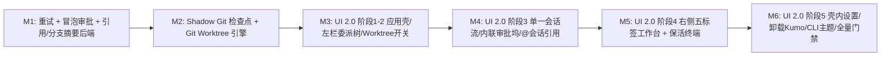

# 018 · v0.1.6 版本设计（并行工作树、影子检查点、UI 2.0 工作台、委派收口与自动重试统一技术方案）

> **状态**：**定稿**（2026-11-27 立项并由维护者按推荐全部拍板确认；基于 `v0.1.5` 发布基线 `ef21045` 与本地 `F:\Project\aigc` 十一套开源编码框架源码级核实编写，在 `v0.1.6` 分支按 M1–M6 全量实施）。
> **定位**：`v0.1.6` 的版本级总体技术方案与跨包实施编排。桌面渲染层视觉规范、原生 UI 原语、Zustand 四域切片与五阶段界面重构细则以已定稿的 [017 UI 2.0 工作台架构规范](017-ui-v2-workbench.md) 为准；跨会话引用与委派前置数据模型继承 [007](007-v0.1.3-cross-session-reference-and-delegation.md)；模型错误分类继承 [001 §4.2](001-agent-framework-design.md#42-错误分类与重试)；**本文负责补齐五大后端与跨栈子系统的完整技术设计、开源对标取舍、协议/API 增量、里程碑编排与验收门禁**。
> **源码级核实依据（A 级实测路径与行号）**：
> - 本仓 `v0.1.5` 基线：`packages/core`、`packages/host`、`packages/cli`、`packages/desktop`、`scripts/desktop-package.ts`、`scripts/check-desktop.ts`；
> - `F:\Project\aigc` 本地仓：`t3code`、`opencode`、`orca`、`ZCode`、`CodeWhale`、`PI-Desktop`、`PiDeck`、`codex`（`codex-rs`）、`codex-host`、`Claude-Code`、`maka`、`pi`。

---

## 0. 一句话定义与版本收口

`v0.1.6` = **把 Kapibala 从「单工作目录串行会话器」升级为「支持多 Agent 同仓并行隔离、轮次级文件可逆回滚、并排多标签工程检视与高可用自愈的多代理编码工作台」**：

1. **物理隔离层（Git Worktree）**：在宿主层提供本地 `/delegate`、`spawn_agent(isolation: 'worktree')` 与外部代理（`acp` / `claude-cli` / `codex-app-server` / `pi-rpc`）共用的受管工作树生命周期，解除同仓库单写者锁阻塞，支持冲突隔离式本地合并审阅与 Windows Junction 安全清理；
2. **文件可逆层（Shadow Git Checkpoints）**：在 `~/.kapibala/checkpoints/` 维护零 `.git` 污染的外部侧挂快照库，打通本地 `run_command` 与黑盒外部代理轮次的整轮真实文件 Diff，支持按归因路径定向回滚并联动本地 `regenerate` / `/branch`；
3. **协同收口层（委派、冒泡审批与引用）**：修复子代理规则继承与后台运行期审批路由断层，落地子代理审批向父会话冒泡、桌面侧栏委派层级树可见化（`D3.x` + `U1.7`）、桌面 `@` 跨会话引用弹层（`R3.x`）、压缩引用溯源索引（`R2.1`）与跨分支摘要（`R2.2` `branchWithSummary`）；
4. **工程检视层（UI 2.0 墨工坊 + 右侧多标签工作台 + 保活终端）**：按 [017](017-ui-v2-workbench.md) 全量重塑桌面渲染层并彻底卸载 `@cloudflare/kumo`，打通右侧可拖拽多标签工作台（`Diff` / `Preview` / `Files` / `Terminal` / `Inspector`），在 `agent-host` 落地惰性加载 `node-pty` 会话级保活终端与本地开发端口沙箱预览；
5. **流式韧性层（模型请求自动重试与断流恢复）**：在 Core 模型循环落地有限指数退避重试、SSE 分块空闲超时守卫、`Retry-After` 解析与半截流式输出回滚（`stream_reset`），保留本轮已完成工具结果不重放。

### 0.1 交付矩阵（六条轨道，全部计入本版范围）

| 轨道 | 主题 | 主要改动包 | 关联规范 |
|:---:|---|---|---|
| **A** | Git Worktree 并行物理隔离与本地合并审阅 | `core`（钩子 + `.git` 文件保护）+ `host` + `cli` + `desktop` | 本文 §3 |
| **B** | Shadow Git 工作区检查点与全量真实 Diff | `host` + `core`（回退联动）+ `cli` + `desktop` | 本文 §4 |
| **C** | 子代理审批冒泡、桌面委派收口与 `@` 跨会话引用 | `core` + `host` + `cli` + `desktop` | 本文 §5 + [007](007-v0.1.3-cross-session-reference-and-delegation.md) |
| **D** | 右侧五标签工作台宿主与会话级保活终端 | `host` + `desktop` + `scripts` | 本文 §6 + [017](017-ui-v2-workbench.md) + [012](012-v0.1.4-artifact-preview.md) |
| **E** | 模型请求自动重试、SSE 空闲守卫与断流恢复 | `core` + `host` + `cli` + `desktop` | 本文 §7 + [001 §4.2](001-agent-framework-design.md#42-错误分类与重试) |
| **UI** | UI 2.0「墨工坊 Ink Atelier」五阶段全量重构、T3 Code 式首栏「常规」设置（黑白主题、中英双语、字体与字号、快捷键与确认项）、CLI 主题同构 | `desktop` + `cli` + `scripts` | [017](017-ui-v2-workbench.md) §1–§9 |

### 0.2 本版明确不做（Non-Goals & Anti-Goals）

- **不升本地 Wire 主版本号**：继续保持整数 `PROTOCOL_VERSION = 2` 不变，新增方法与事件严格通过 `SERVER_CAPABILITIES` 增量能力字符串（`'references'`、`'worktree'`、`'checkpoint'`、`'retry'`）门控；
- **不向 Core / CLI / MCP 引入任何运行时依赖或原生 C++ 插件**：`@kiturone/kapibala` 保持 **0 运行时依赖**与严格 Headless；`node-pty` 与 `@xterm/*` 严格限制在私有包 `packages/desktop` 内，不影响 `npm install -g @kiturone/kapibala-cli` 与 Node 20 门禁；
- **不把每个 Worktree 拆成独立「项目空间（Workspace）」**：避免侧栏碎片化、项目信任丢失与重复进程开销（吸收 `ZCode` v2 推翻 v1 的核心教训）；
- **不在共享工作区执行全目录 `git reset --hard` 或 `git clean -fd`**：回滚严禁误删用户原有的未跟踪文件或会话外改动；
- **不依赖 `gh` CLI 或托管 GitHub OAuth 做 PR 创建**：本版聚焦本地分支隔离、Diff 审阅与冲突隔离式合并回主工作区，远端 `git push` 与 PR 创建由用户在内置终端或自有 Git 工具按需执行；
- **不做外部代理会话的跨进程对话截断回滚**：外部代理（`acp` / `claude` / `codex` / `pi`）支持整轮真实文件 Diff 审阅与「仅还原磁盘文件到指定轮次」，不伪造截断其私有会话存储；
- **不做公网任意网页内嵌浏览器**：`Preview` 标签 URL 栏仅内嵌预览本机回环开发服务（`localhost` / `127.0.0.1` / `[::1]`），公网 `https://` 链接统一引导至系统浏览器打开；
- **不做多模态图片输入、`apply_patch`、权限规则 P1 三级记忆与 `process_exit` 监视**：按 [RELEASES.md](../RELEASES.md) 锁定排期留在 `v0.1.7`。

---

## 1. `F:\Project\aigc` 源码级对标与核心取舍（A 级核实）

> 遵循 `014 §0.3` 证据纪律：以下全部经本轮直接读取 `F:\Project\aigc` 源码文件与行号核实；已移除的机制（如 `codex` 已废弃的 `GhostCommit`）如实标注，绝不引用过期传闻。

### 1.1 Git Worktree 并行隔离对标

| 开源项目 | 核实源码位置 | 核心机制 | 本版吸收点 / 明确舍弃点 |
|---|---|---|---|
| **ZCode** | `docs/git/worktree.md:16-75, 525-574, 784-800`<br>`packages/shared/src/managed-worktree/layout.ts:6-93`<br>`packages/services/src/git/managed-worktree/{gitWorktreeRepo.ts:172-464, trust-identity.ts:56-97, removal.ts:54-112}` | `workspace_key` 锚定主仓库根，`root_path` 存会话 `cwd`；`~/.zcode/worktrees/<4hex>/<repo>` 短路径桶；4 步 `.git` 双向回链验真继承信任；9 步删除门闩联动终端与驻留会话 | **吸收**：项目身份与执行目录解耦、4 位十六进制短路径桶（防 Windows 260 字符溢出）、4 步 `.git` 双向回链验真、删除前终端与活动运行门闩、`.worktreeinclude` 拷贝。<br>**不抄**：纯 `--detach` 无分支名模式（本版需支持具名分支供合并与状态展示） |
| **t3code** | `apps/server/src/vcs/{GitVcsDriverCore.ts:6622-6992, worktreeRemoval.ts:48-216}`<br>`apps/server/src/workspace/workspaceLease.ts:7-114`<br>`packages/shared/src/git.ts:14-130` | `t3/<8hex>` 分支与 D/F 引用冲突回退（`t3-<8hex>`）；`git config` 记录 `t3-base`；按 `cwd` 细化写锁 + 路径包含关系 `restore` 预留锁；Windows NTFS Junction 安全删除 | **吸收**：分支 D/F 冲突回退、本地记录 `kpblBaseCommit`/`kpblBaseRef`、按 `executionRoot` 分桶租约、**Windows 绝不直接对含 Junction 目录调 `git worktree remove`**。<br>**不抄**：`t3.json` 自定义 setup shell 脚本自动执行 |
| **PI-Desktop** | `crates/host-core/src/session_worktrees/merge.rs:60-243, 408-709` | `preview()` 计算对称 Diff 与 `preview_token`；`land()` **先在 Worktree 内 merge 主分支**，冲突留在 Worktree 内不污染主目录，通过后对主目录执行原子 `git merge --ff-only` | **完整吸收**：作为本版「合并回主工作区」的核心算法，彻底杜绝把用户主工作区搞成冲突半残态 |
| **orca** | `src/main/git/worktrees/creation/worktree-add.ts:41-123`<br>`src/main/ipc/worktrees/removal/{worktree-at-risk-local-files.ts:89-328, worktree-branch-removal.ts:17-196}` | `--no-track -b <branch>` 防误绑 `origin/main` 为 push 上游；删除前扫描被 gitignore 但有改动的敏感文件（如 `.env*`）；CAS `update-ref -d` 安全删分支 | **吸收**：`--no-track -b`、删除前敏感被忽略文件风险提示、`git branch -d` 保守删分支。<br>**不抄**：后台投机预建 Worktree 池（增加磁盘与锁复杂度） |
| **Claude-Code & codex** | `Claude-Code/src/utils/worktree.ts:66-87, 199-303`<br>`codex/codex-rs/worktree/src/{git.rs:27-56, 99-182, lib.rs:301-317}` | 创建时不跑网络 `git fetch`；清洗继承的 15 个 `GIT_*` 环境变量并设 `GIT_TERMINAL_PROMPT=0` | **吸收**：零网络阻塞本地切出、`GIT_*` 环境清洗、Windows `-c core.longpaths=true`。<br>**严禁照搬**：`Claude-Code` 的进程级 `process.chdir()` 与改写共享 `.git/config` `core.hooksPath` |

### 1.2 Shadow Git 检查点与全量 Diff 对标

| 开源项目 | 核实源码位置 | 核心机制 | 本版吸收点 / 明确舍弃点 |
|---|---|---|---|
| **opencode** | `packages/core/src/{snapshot.ts:1-250, git.ts:24-63, 392-1382}`<br>`packages/core/src/session/{runner/step.ts:79-102, 295-322, diff.ts:38-149, revert.ts:22-112}` | 外部 `--git-dir` + `--work-tree`；**`objects/info/alternates` 共享主仓对象库 + 拷贝主仓 index 预热**；`update-index -z --stdin` 增量暂存；**按轮次归因文件集定向还原** + `stage` 可撤销恢复 | **吸收**：外部侧挂库零污染、`alternates` 零拷贝极速初始化、`update-index` 高性能暂存、**只还原 Agent 实际触碰过的归因路径集（不动用户原有未跟踪文件）**。<br>**不抄**：无引用裸 `TreeID` 自写二进制 `.idx` 解析器（改用标准 `refs/kpbl/...` 锚定供原生 `git gc` 回收） |
| **CodeWhale** | `crates/snapshot/src/{repo.rs:208-375, 507-664, 883-965, 2550-2577, 2797-2812, paths.rs:46-59}` | 侧挂库原生支持**非 Git 普通文件夹**；内置 `BUILTIN_EXCLUDES` 写入 `info/exclude`；拦截 `/`、`C:\`、`$HOME`、`Desktop/Downloads` 危险根；强制 `pre-restore` 安全快照；500MB 自动修剪 | **吸收**：非 Git 工作区（含默认空间）无缝兜底、危险大目录熔断、`BUILTIN_EXCLUDES`、`pre-restore` 安全快照与 500 MiB 容量淘汰 |
| **t3code** | `apps/server/src/orchestration-v2/{CheckpointService.ts:37-581, RunExecutionService.ts:850-900, 1091-1170}` | 专为黑盒外部 ACP/CLI 设计：启动轮次时并发 `forkBaseline`（**5 秒超时预算**，连续超时自动熔断跳过），轮次终态异步捕获 post-turn 快照 | **吸收**：并发前置基线采样隐藏延迟、5s 慢盘熔断器、统一包裹本地与外部代理轮次首尾。<br>**不抄**：往用户 `.git/refs/t3/...` 写入隐藏引用 |
| **PiDeck & ZCode** | `PiDeck/src/main/rewind/{checkpointCore.ts:100-230, checkpointConstants.ts:20-38}`<br>`ZCode/packages/services/src/git/repo/gitCheckpointRepo.ts:134-238` | `PiDeck` 三层未跟踪文件预算（单文件 10 MiB / 单目录 200 文件 / 累计 64 MiB 防 1.1 GB I/O 风暴）；`ZCode` 回滚前用 `git hash-object --no-filters` 逐文件做三路冲突预检 | **全部吸收**：三层未跟踪文件硬预算 + 回滚前哈希比对冲突告警（防静默覆盖用户事后手动修改） |
| **codex / orca / maka** | `codex-rs/features/src/lib.rs:562-564`（`Stage::Removed`） | `codex` 的 `GhostCommit` 已正式移除；`orca` 与 `maka` 仅做对话回退无文件检查点 | 作为反面核实记录，不引用为有效实现 |

### 1.3 保活终端、子代理审批冒泡与自动重试对标

| 领域 | 核实源码位置 | 吸收的关键机制 |
|---|---|---|
| **保活终端与打包** | `ZCode/packages/services/src/terminal/terminalService.ts:31-44, 101-144, 200-373`<br>`PiDeck/src/main/terminal/{TerminalSessionManager.ts:68-180, terminalReplayBuffer.ts:14-71}`<br>`PiDeck/src/renderer/src/components/terminal/TerminalDock.tsx:4-72` | ① **`node-pty` 惰性 `import()`**（缺 `.node` 绝不在宿主启动期崩掉整应用）；② macOS `app.asar.unpacked` 下 `spawn-helper` 自动 `chmod 0o755` 修复；③ Windows `useConptyDll: true` 报 126/DLL 错误时自动降级 `useConptyDll: false`；④ GUI 启动补齐 UTF-8 locale 与 macOS Homebrew `PATH`；⑤ **`200K` 字符分段 `O(1)` 回放缓冲 + 16ms IPC 合批**（根治首帧提示符在订阅前丢失导致空白终端，并支持跨会话切换无损恢复）；⑥ `@xterm/xterm` 动态按需加载，不进首屏 bundle |
| **子代理审批冒泡** | `ZCode/apps/zcode-cli/packages/core/src/{runtime/helpers/subagent-interaction-broker.ts:17-45, subagent/background-stall.ts:306-365}`<br>`Claude-Code/src/hooks/toolPermission/handlers/interactiveHandler.ts:204-231`<br>`opencode/packages/core/src/permission.ts:379-391` | ① **Broker 包装器改写路由至根会话 + `origin ?? ...` 保留最内层子代理身份**（多层嵌套 `root → A → B` 准确展示 `B`）；② **等待人工审批期间暂停子代理运行超时计时器**（防用户思考超 5 分钟误杀子代理）；③ 批准 `allow_session` 后立即重判同队列待批兄弟请求，免除重复弹窗 |
| **模型自动重试** | `Claude-Code/src/{services/api/withRetry.ts:519-548, query.ts:712-741, utils/sleep.ts:14-54}`<br>`opencode/packages/{ai/src/provider-error.ts:218-291, core/src/model-retry.ts:11-90}`<br>`pi/packages/ai/src/utils/{provider-retry.ts:47-77, retry.ts:7-35}`<br>`ZCode/apps/zcode-cli/packages/adapters/src/model/runner-retry.ts:53-59` | ① 在通用 `429` 判定前**优先剥离配额/余额耗尽错误码**（`402`、`insufficient_quota`、智谱 `1304`/`1308` 等，直接标不可重试）；② `ContextOverflowError` 严格走既有 1 次压缩分支，绝不退避空等；③ 解析 `x-should-retry`、`retry-after-ms` 与 `retry-after`（超 `60s` 立即失败提示，不盲等；命中 `Retry-After` 加 `0..+20%` 正向防惊群抖动）；④ SSE 分块 `90s` 空闲看门狗 + 未见终止帧 EOF 归入可重试流中断；⑤ 桌面通过 `stream_reset` 清空当前未提交步的半截流式块，已落盘前序工具步 100% 保留；⑥ `AbortSignal` 唤醒后立即 `removeEventListener` 防闭包泄漏 |

---

## 2. 本仓 `v0.1.5` 代码基线核查与发现的隐性缺陷

本轮对本仓源码逐行审计确认了以下接缝与 **5 处必须在 `v0.1.6` 一并修补的真实隐患**：

1. **隐患 1 — 链接工作树的 `<worktree>/.git` 文件未被沙箱写保护**（`packages/core/src/capabilities/security/sandbox.ts:76-98`）：
   - `isProtectedWorkspacePath` 目前仅拦截 `.git/hooks`、`.git/config`、`.git/modules` 子路径；而在 `git worktree` 中，工作树根下的 `.git` 是一个普通文本文件（内容为 `gitdir: <mainRepo>/.git/worktrees/<name>`）。若不将 `.git` 精确路径纳入写硬禁区，`Auto` / `FullAccess` 下的写入工具可篡改 `.git` 指向从而逃逸仓库边界。
2. **隐患 2 — 子代理策略丢失父会话 `permissionRules`**（`packages/host/src/host/subagent-runner.ts:126-155, 282-305`）：
   - `deriveChildPolicy`（`subagent-policy.ts:429-442`）已计算出继承父会话 `deny`/`ask` 的 `derivedPolicy.rules`，但 `subagent-runner.ts` 创建与恢复子 `AgentSession` 时只传了 `mode`，漏传 `permissionRules: derivedPolicy.rules`。
3. **隐患 3 — 后台子代理在父轮次结束后触发 `ask` 时审批链路断裂**：
   - 本地宿主 RPC（`packages/cli/src/local-host/server.ts:60-84`）在父会话 `entry.active === undefined`（父轮次已结束、后台 `detached` 子代理仍在跑）时无运行身份，直接拒绝审批；
   - 桌面宿主（`packages/desktop/src/agent-host/desktop-host.ts:812-815, 1448-1498`）在父轮次结束后仍残留上一轮 `slot.run.runId`，导致后台子代理审批被贴上过期 `runId`，且 `ApprovalRequest` 无任何子代理身份字段。
4. **隐患 4 — 三套模型 Provider 流中断重试标志与传输入口不一致**（`packages/core/src/models/`）：
   - `AnthropicProvider`（`anthropic/index.ts:424-432`）与 `OpenAIResponsesProvider`（`openai-responses/index.ts:304`）走 `openModelResponse`，而 `OpenAICompatibleProvider`（`openai-compatible/index.ts:138-204`）裸调 `fetch()`；
   - 流中途断开时，`AnthropicProvider` 默认归类为 `retryable: true`，后两者却硬编码传了 `retryable: false`（`openai-responses:653-658`、`openai-compatible:443-450`）；且 `http.ts:60-123` 在响应头返回后立即 `clearTimeout`，无 SSE 分块读取超时。
5. **隐患 5 — 桌面打包器不打包 `node_modules` 且零原生模块先例**（`scripts/desktop-package.ts:154-167, 438-448`）：
   - 当前全仓 **0 个 `.node` 原生插件**；`desktopPackageConfig.files` 仅打包 `'out/**/*'`（由 `electron-vite` 单文件 bundle），且 `pnpm deploy --ignore-scripts` 跳过安装脚本、`asar: true` 无 `asarUnpack`。接入 `node-pty` 必须显式配置 external、`files` 白名单、`asarUnpack` 与 N-API 预编译校验，否则四平台 `desktop-unsigned` 安装副本 smoke 必挂。

---

## 3. 主题 A：Git Worktree 并行物理隔离技术设计

### 3.1 核心身份模型：`projectRoot` 与 `executionRoot` 双根解耦

```text
用户项目主仓: F:\Project\demo  (projectRoot —— 决定 projectKey、侧栏空间归属、信任状态、跨会话引用桶)
   ├── 会话 1 (默认共享主仓):    executionRoot = F:\Project\demo
   ├── 会话 2 (本地委派 Worktree): executionRoot = C:\Users\Thor\.kapibala\worktrees\a3f9\demo  [⎇ kpbl/fix-auth-a3f9]
   └── 会话 3 (外部 Codex Worktree): executionRoot = C:\Users\Thor\.kapibala\worktrees\7c12\demo  [⎇ kpbl/refactor-ui-7c12]
```

- **存储与归属不变量**：
  - 本地会话历史仍存于 `~/.kapibala/sessions/<computeProjectKey(projectRoot)>/<conversationId>.jsonl`；`SessionHeader` 新增可选字段 `worktree?: SessionWorktreeBinding`（向后兼容 Schema v2，无需迁移旧会话）；
  - 外部代理会话登记簿 `~/.kapibala/external/sessions.json` 的 `ExternalSessionRecord` 拆分 `projectRoot`（空间归属与信任根）与 `workspaceRoot`（实际传给外部 CLI `cwd` 的 `executionRoot`）及可选 `worktree?: SessionWorktreeBinding`。
- **并发解锁与同目录跨子系统护栏**：
  - Core `AgentSession`、`PathSandbox` 与 `WorkspaceLeaseCoordinator` 接收 `executionRoot`：不同 Worktree 拥有独立物理路径，天然落入不同租约桶，**同仓多 Agent 100% 并行读写零阻塞**；
  - 新增宿主级轻量协调器 `ExecutionRootCoordinator`（`packages/host/src/host/worktree/coordinator.ts`）：横跨 `ManagedHostSession` 与 `ExternalSessionService` 登记活动写运行，消除 `v0.1.5` 同一物理目录下本地会话与外部会话互不感知的竞态。
- **Core 沙箱加固**：
  - 在 `packages/core/src/capabilities/security/sandbox.ts` 的 `isProtectedWorkspacePath` 中，新增对根及任意子目录下 `.git` **精确路径本身**（无论目录或 worktree `.git` 指针文件）的写硬禁区拦截。

### 3.2 `WorktreeService` 目录布局、创建与信任验真

位于 `packages/host/src/host/worktree/`（纯宿主服务，经 `@kiturone/kapibala-host/host` 与 `/internal` 导出）：

```ts
/** 会话绑定的受管 Git Worktree 元数据。 */
export interface SessionWorktreeBinding {
  readonly id: string;
  readonly projectRoot: string;
  readonly worktreePath: string;
  readonly branch: string;
  readonly baseRef: string;
  readonly baseCommit: string;
  readonly createdAt: number;
}
```

1. **短路径桶布局**：
   - 根目录固定为 `<homeDirectory>/.kapibala/worktrees/<4-hex-bucket>/<repoBasename>`（`bucket` 取随机 4 位小写十六进制，以非递归 `fs.mkdirSync` 原子抢占，冲突重试最多 64 次；macOS 在根下写 `.metadata_never_index`）。
2. **分支命名与零网络切出**：
   - 分支名生成：`kpbl/<sanitizedSlug>-<bucket>`（无标题时为 `kpbl/task-<bucket>`）；调用前检查本地 `refs/heads/kpbl` 是否作为单文件分支存在，若是则自动扁平化为 `kpbl-<sanitizedSlug>-<bucket>`（防 Git D/F 引用锁死）；
   - 基线解析：仅解析本地 `${baseRef ?? 'HEAD'}^{commit}`，**绝不在创建热路径执行联网 `git fetch`**；若主仓正处于 `MERGE_HEAD` / `rebase-merge` / 未决冲突态则明确拒绝创建（`WORKTREE_REPO_UNMERGED`）；
   - Git 环境清洗：统一经 `gitCleanEnv()` 剥离继承的 `GIT_DIR`、`GIT_WORK_TREE`、`GIT_INDEX_FILE`、`GIT_COMMON_DIR`、`GIT_OBJECT_DIRECTORY`、`GIT_ALTERNATE_OBJECT_DIRECTORIES`，注入 `GIT_TERMINAL_PROMPT=0`、`GIT_ASKPASS=""`，Windows 自动追加 `-c core.longpaths=true`；
   - 执行序列：`git worktree add --lock --reason kpbl-init --no-track -b <branch> <worktreePath> <baseCommit>` → 写入 worktree 局部元数据 `branch.<branch>.kpblBaseCommit` / `kpblBaseRef` → 若主仓存在 `.worktreeinclude` 则按规则拷贝被忽略的常规文件（禁符号链接逃逸，单文件 `≤ 8 MiB`、总计 `≤ 32 MiB`，使用 `COPYFILE_EXCL | COPYFILE_FICLONE`）→ `git worktree unlock <worktreePath>`。任一步骤失败立即回滚注册并清理空桶。
3. **四步 `.git` 双向回链信任校验（`verifyManagedWorktreeLink`）**：
   - 全部使用 `fs.realpathSync.native`（无子进程开销，读取上限 `64 KiB`）：
     1. `<worktreePath>` 位于受管 `~/.kapibala/worktrees/` 之下，且 `<worktreePath>/.git` 为普通文件；
     2. 解析 `gitdir:` 指向 `<adminDir>`，校验其位于 `<projectRoot>/.git/worktrees/<name>`；
     3. 读取 `<adminDir>/gitdir`，校验其 `realpathSync.native` 指回 `<worktreePath>/.git`；
     4. 读取 `<adminDir>/commondir`，校验其 `realpathSync.native` 恒等于已信任的 `<projectRoot>/.git`。
   - 任一环节失配立即拒绝继承项目信任（防伪造 `.git` 指针文件越权）。

### 3.3 冲突隔离式本地合并审阅与 Windows 安全清理

1. **本地合并审阅（`previewMerge` → `applyMerge`）**：
   - `previewMerge(worktreeId)`：返回领先/落后提交数、相对 `baseRef` 的变更文件清单（`added / modified / deleted / renamed` + `+A -D`）、主工作区与工作树清洁度，以及对 `worktreeHead + mainHead + worktreeStatus` 计算的 `previewToken`；
   - `applyMerge({ worktreeId, previewToken, commitMessage? })`：
     - 核对 `previewToken` 未漂移且主工作区当前分支仍为目标分支、受影响路径无未提交脏改动；
     - 若工作树内仍有未提交改动，按 `commitMessage`（缺省自动生成摘要标题）在工作树分支内先创建一个提交；
     - **第一步（工作树内预合并）**：在 `<worktreePath>` 内执行 `git merge --no-edit refs/heads/<targetBranch>`。若发生代码冲突，立即返回 `{ status: 'conflict', conflictedFiles }`——**主工作区毫发无损**，用户可直接让当前工作树会话里的 Agent 解决冲突后重试合并；
     - **第二步（主工作区原子快进）**：预合并通过后，在 `<projectRoot>` 执行 `git merge --ff-only <worktreeHead>`，瞬间无冲突落入主分支。
2. **Windows NTFS Junction 安全删除与三路脏检查（`removeWorktree`）**：
   - 前置门闩：同步获取该 `worktreePath` 删除锁，拒绝存在运行中本地/外部轮次的目标；自动关闭绑定在该目录下的空闲会话句柄与空闲保活终端；
   - 三路脏状态预检（`force !== true` 时任一命中均拒绝并返回明确原因供前端弹确认框）：
     1. `git -c status.showUntrackedFiles=normal status --porcelain -z` 非空（含未提交或新文件）；
     2. `git rev-list --count <baseRef>..HEAD` `> 0` 且尚未并入 `<baseRef>`（防误删未合并提交）；
     3. 被忽略但相对主仓发生修改或新增的非常规缓存文件（重点检测 `.env*`）；
   - **Windows 删除规避协议**：先读取备份 `<worktreePath>/.git` 字节 → 用 Node `fs.rm(worktreePath, { recursive: true, force: true })` 安全解除内部 NTFS Junction（如 `node_modules` 软链）而不追随删除主仓目标文件（若因句柄占用中途报错则写回 `.git` 恢复可识别态并报 `WORKTREE_BUSY`）→ 最后调 `git worktree prune` 与 `git branch -d <branch>`（`force: true` 时用 `git update-ref -d` CAS 删除）。

### 3.4 入口接线

- **Core `AgentRuntime`**：移除 `runtime.ts:332-339` 对 `isolation: 'worktree'` 的硬拦截，新增可选 `SubagentWorktreeProvider` 注入接口；`ephemeral` 子代理终态无改动时自动回收空工作树，有改动或 `detached` 委派会话持久保留工作树；
- **CLI**：`/delegate` 与 `/external start` 新增 `--worktree [--branch <name>]`；新增 `/worktrees`（`list | status | diff | merge | remove | prune`）；
- **桌面 Launchpad / 新建对话**：`OmniComposer` 底栏提供轻量 `⎇ 独立工作树` 开关胶囊（非 Git 空间自动隐藏）。

---

## 4. 主题 B：Shadow Git 工作区检查点与全量 Diff 技术设计

### 4.1 侧挂存储结构与极速初始化

位于 `packages/host/src/host/checkpoint/`，目录结构如下：

```text
~/.kapibala/checkpoints/
  └── <projectKey>/
        └── <sha256_16(executionRoot)>/
              ├── git/                      # 独立 bare/side Git 仓库 (--git-dir)
              │   ├── objects/info/alternates  # 若宿主是 Git 仓，指向 <commonGitDir>/objects 零拷贝复用
              │   ├── info/exclude          # 写入 BUILTIN_EXCLUDES
              │   ├── index                 # 持久预热缓存索引
              │   └── refs/kpbl/sessions/<sessionId>/turn-<ordinal>
              ├── checkpoint.lock           # 进程间互斥锁
              └── manifest.jsonl            # 追加式检查点元数据索引
```

- **危险目录熔断**：若 `executionRoot` 为文件系统根目录（`/`、`C:\`）、用户主目录（`$HOME`）或一级系统个人目录（`Desktop`、`Documents`、`Downloads`、`Library`、`AppData`），直接禁用检查点并返回 `{ available: false, reason: 'unsafe_root' }`；
- **Git 仓与非 Git 仓双模初始化**：
  - 若 `executionRoot` 属于 Git 仓库：创建 `git/` 后写入 `objects/info/alternates` 指向主仓 `<commonGitDir>/objects`，并拷贝用户当前 `.git/index` 作为初始 `git/index`（执行 `update-index --no-split-index` 并保留原 `mtime`），首轮快照免除全仓重算哈希；
  - 若 `executionRoot` 为普通非 Git 文件夹（含默认空间 `~/.kapibala/workspaces/default`）：直接 `git init --bare`，写入同一套 `BUILTIN_EXCLUDES`，无需用户 `git init` 即可享受检查点与 Diff。
- **固定 Git 配置与排除表**：
  - 每次执行固定带 `--git-dir <sideGit> --work-tree <executionRoot>`，配置 `core.autocrlf=false`、`core.longpaths=true`、`core.fsmonitor=false`、`core.quotepath=false`、`core.symlinks=true`、`gc.auto=0`、`core.hooksPath=`（空）；
  - `BUILTIN_EXCLUDES` 固定排除：`.git`、`.kapibala`、`node_modules/`、`dist/`、`out/`、`build/`、`target/`、`.next/`、`.nuxt/`、`.turbo/`、`coverage/`、`.venv/`、`venv/`、`__pycache__/`、`*.pyc`、`*.o`、`*.obj`、`*.dll`、`*.so`、`*.dylib`、`*.exe`。

### 4.2 轮次首尾捕获流水线与三层预算熔断

```text
Turn N 启动 ──┬─> [并发] capturePreTurn(ordinal=N) ──(5s 超时预算)──> 记录 startTree
              └─> 模型请求 TTFT / 外部代理会话唤醒 ─────────────────┴─> 放行首个工具执行或外部 prompt
                                                                           │
Turn N 结算 <── capturePostTurn(ordinal=N) <── (completed / failed / cancelled)
   └─> diff(startTree, endTree) 产出 TurnDiffSummary { +additions, -deletions, changedFiles[] }
   └─> 写入 manifest.jsonl 并更新 refs/kpbl/sessions/<sessionId>/turn-<N>
```

1. **增量索引更新（避免 `git add -A` 全盘扫描）**：
   - 硬链或拷贝 `git/index` 到同目录临时文件 `GIT_INDEX_FILE=git/index.tmp-<pid>-<seq>`；
   - 并行执行 `git diff-files --name-only -z` 与 `git ls-files --others --exclude-standard --exclude-from=<userExclude> -z`（若宿主是 Git 仓，额外经主仓 `git check-ignore --no-index -z --stdin` 过滤嵌套 `.gitignore`）；
   - **三层未跟踪文件预算检查**：
     - 单文件大小上限：`10 MiB`（超出记入 `skippedLargeFiles`，不入库）；
     - 单未跟踪子目录文件数上限：`200` 个（防构建产物目录漏配 `.gitignore`）；
     - 单次新增未跟踪总字节上限：`64 MiB`；
   - 通过 `git update-index --add --remove --replace -z --stdin` 批量更新临时索引，`git write-tree` 生成 `treeOid`，原子替换回 `git/index`；
   - **慢盘熔断器**：`capturePreTurn` 限时 `5,000ms`；同一会话连续 2 次超时后标记该会话降级跳过自动快照，绝不卡死正常对话。

### 4.3 全量 Diff 查询与按归因路径安全回滚

1. **统一 Diff 读取契约（同时服务本地会话与外部代理会话）**：
   - **单轮 Diff**：对比 `turn[k].startTree` 与 `turn[k].endTree`；
   - **整会话累计 Diff**：将各轮归因变更文件合并，对比首次触碰前的 `startTree` 与最新 `endTree`（运行中轮次用临时索引 + `git add --intent-to-add` 实时对比工作区）；
   - Windows 命令行长度保护：路径列表走 `--pathspec-from-file=- --pathspec-file-nul`，单文件 Patch 截断上限 `256 KiB`、单次总 Patch 上限 `2 MiB`（UTF-8 字符边界安全截断，标记 `truncated: true`）；
   - **会话看板联动**：`buildSessionEvidence` 在存在检查点记录时，优先使用检查点捕获的真实磁盘变更（覆盖 `run_command` 与外部代理改动），无检查点记录的历史旧会话平滑回退至既有 `ToolResultBlock.execution.facts.diff`。
2. **归因路径定向回滚（`restoreCheckpoint`）**：
   - 当用户回退到第 $K$ 轮结束态（或第 $K$ 轮开始前 `ordinal = K - 1`）时：
     1. **计算最小归因集**：正向扫描 $(K+1 \dots N)$ 的 `manifest` 记录，仅收集 Agent 在这些轮次实际修改/新增/删除过的路径集合 `attributedPaths`，映射每个路径在最早被触碰轮次 `startTree` 中的目标状态（`blobOid` 或 `absent`）；**用户未纳入这些轮次改动的自有未跟踪文件与手动修改 100% 不触碰**；
     2. **三路冲突预检**：对 `attributedPaths` 执行 `git hash-object --no-filters` 与第 $N$ 轮 `endTree` 比对；若用户在第 $N$ 轮结束后又手动编辑过其中某些文件，且 `force !== true`，立即中止并返回 `{ status: 'conflict', conflicts: string[] }` 供界面二次确认；
     3. **强制 `pre-restore` 备份快照**：先写入一条 `kind: 'pre-restore'` 快照（支持误回滚后一键撤销恢复！）；
     4. **原子还原**：使用临时 `GIT_INDEX_FILE`（绝不触碰用户真实 `.git/index`）对需恢复文件执行 `git checkout <sourceTree> --pathspec-from-file=- --pathspec-file-nul`；对回退点尚不存在的新增文件校验父目录无符号链接逃逸后执行 `fs.rm` 并清理变空的父目录。
3. **与会话操作联动**：
   - 本地会话：`ManagedHostSession.regenerate({ restoreFiles?: boolean, force?: boolean })` 与分支切换/分叉支持在同一把会话锁与 `ExecutionRootCoordinator` 写锁内原子完成「回退分支 + 还原归因磁盘文件」（若文件冲突被拒，对话分支亦不切换，保持强一致）；
   - 外部代理会话：右侧工作台 `Diff` 标签与轮次尾栏提供「还原此轮文件改动」独立操作（明确提示仅还原磁盘文件、不改写外部代理自身聊天记录）；
   - 容量修剪：每项目桶上限 `500 MiB` 或保留最近 30 个已终结会话的检查点引用，超限时删除最老已终结会话的 `refs/kpbl/sessions/<oldId>/*` 并异步执行一次 `git gc --prune=now --quiet`。

---

## 5. 主题 C：子代理审批冒泡、本地委派收口与跨会话引用

### 5.1 子代理审批冒泡闭环（修复三处现存断层）

```text
[子代理 B (depth=2)] ──requestApproval──> SubagentApprovalBroker (保留最内层 B 的 subagentOrigin)
                                               │
[子代理 A (depth=1)] ──透传不覆盖 origin────────┘
                                               ▼
                         父会话 SessionApprovalHub (常驻绑定父 conversationId，与父轮次 idle 解耦!)
                        ┌──────────────────────┼──────────────────────┐
                        ▼                      ▼                      ▼
              [Desktop: ApprovalDeck]   [Wire: approval/request]  [CLI REPL: 暂停输入行弹出审批]
              • 左栏父会话挂「待审批」琥珀点  • 只要控制连接仍 attach 即送达   • 若正处密钥输入则排队等待
              • 展示「↳ 子代理 · 角色/任务名」 • allow_session 同步同树缓存     • 审批挂起期暂停子代理 5m 超时!
```

1. **补齐规则继承（修补隐患 2）**：
   - 在 `packages/host/src/host/subagent-runner.ts` 创建与恢复子 `AgentSession` 时，显式传入 `permissionRules: derivedPolicy.rules`，确保父会话的 `deny` / `ask` 规则 100% 生效。
2. **溯源元数据与多层嵌套代理（`SubagentOrigin`）**：
   - 在 `packages/core/src/capabilities/security/approval.ts` 的 `ApprovalRequest` 新增可选只读字段：
     ```ts
     export interface SubagentApprovalOrigin {
       readonly agentId: string;
       readonly role: SubagentRole;
       readonly description: string;
       readonly childSessionId?: string;
       readonly parentSessionId: string;
     }
     ```
   - `createSubagentApprovalChannel` 采用 `request.subagentOrigin ?? currentOrigin` 规则：多层子代理嵌套时始终保留**最内层实际发起调用的子代理身份**，同时路由至根父会话。
3. **会话级常驻 `SessionApprovalHub`（修补隐患 3）**：
   - 将审批队列生命周期从「单次 `run/start` 轮次内」提升至「已打开受管会话句柄级」：即使父会话本轮回答已结束（处于 `idle`）、而后台 `detached` `/delegate` 或异步子代理仍在执行，只要控制端仍处于连接态（Desktop 已打开该空间或后台保活、LocalHost 控制连接仍 `attach`），审批请求照常入队下发，分配独立单调 `approvalId` 而不再复用过期的父 `runId`；
   - 父会话关闭或控制连接断开时，立即向该会话树下所有挂起审批广播 `abort` 并发出 `approval_closed`。
4. **超时守卫暂停与同树批量消解**：
   - **暂停超时钟**：在 `AgentRuntime.runTask` 中，当子代理进入等待人工审批态（`pendingApprovals > 0`）时暂停其 `timeoutMs`（默认 5 分钟）倒计时，审批返回后恢复计时（单次审批自身仍受 `120s` `approvalTimeoutMs` 约束）；
   - **同树批准共享与队列重判**：同一父会话树共享 `TreeApprovalCache`（当子代理显式指定收紧版 `allowedTools` 时仅读不写父缓存，防止缩权子代理污染父级）；用户点击「本会话允许」后，立即遍历当前 `SessionApprovalHub` 队列中等待的兄弟子代理同指纹请求并自动放行，消除重复弹窗。

### 5.2 桌面本地委派可见化（`D3.1–D3.2` + `U1.7` + `D4.2`）

- **契约补齐**：在 `packages/desktop/src/shared/contracts.ts` 的 `SessionSummarySchema`、`DesktopHost.listSessions` 以及本地 Wire `session/list` 返回项中透传可选 `delegation?: { parentSessionId, parentTitle, taskName }`；在 `InspectionSchema` 的活动子任务摘要中补齐 `sessionId?: string`；
- **删除联动**：`DesktopHost.mutateSession('delete')` 删除委派子会话时同步通知已打开父会话句柄调用 `runtime.forgetDelegationSession(conversationId)`；
- **UI 2.0 呈现**：
  - 左栏 `WorkspaceTree` 将本地 `/delegate` 子会话以缩进 `↳ <taskName>` 挂载于父会话下方（父会话被归档或不在首屏列表时，保留独立分组兜底确保不丢入口），点击直接走标准 `SessionStage` 打开，运行中实时看流、终态后直接在 `OmniComposer` 输入续聊；
  - 对话流 `ProcessGroup` 中的 `spawn_agent` / `send_agent` 工具行支持内联子任务状态与一键跳转打开该子会话（`U1.7`）；
- **自动淘汰（`D4.2`）**：在新建委派会话触发 `MAX_RETAINED_DELEGATIONS = 20` 检查时，自动按 LIFO 清理超过 7 天未活动且未置顶、非运行态的最旧终态委派会话（写诊断日志），并补齐 CLI `/delegations prune` 子命令。

### 5.3 跨会话引用闭环（`R2.1` + `R2.2` + `R3.1–R3.3`）

1. **Wire v2 非破坏扩展（修正 `007` 旧 `1.1` 草案）**：
   - `PROTOCOL_VERSION` 保持 `2`；`SERVER_CAPABILITIES` 新增 `'references'`；
   - 新增请求方法 `reference/candidates`、`reference/search`、`reference/read`（只读、原生物理路径同桶校验、零目录创建）；`run/start` 新增可选 `references?: Array<{ sessionId: string; recordId?: string; branchId?: string }>`（客户端只传身份，宿主经既有 `ManagedHostSession.runWithReferences` 在运行锁内冻结读取并脱敏展开）。
2. **桌面 `@` 双模引用弹层（`R3.3`）**：
   - 桌面 `contracts.ts` 同步新增 `reference.{candidates,search,read}` 与 `run.start.references`；
   - `OmniComposer` 输入 `@` 时弹出可切换标签的 `AnchoredPopover`（`文件` / `会话与消息`），同时解除旧 `App.tsx:1669` 在选择外部代理时禁用 `@文件` 补全的限制；选中会话或检索命中的具体消息后，在输入框顶部胶囊托盘挂载可移除的溯源快照 Chip。
3. **压缩溯源保留（`R2.1`）与跨分支摘要（`R2.2`）**：
   - `ContextManager`（`packages/core/src/context/manager.ts`）：保护本轮刚注入的引用消息不被同轮反应式压缩误伤；旧轮进入滚动摘要前先将 `<session-reference>` 大正文降级为紧凑摘要输入，并在生成的 `Checkpoint` 上持久化 `referenceIndex: ReferenceContentSource[]`，确保多轮压缩后仍可追溯历史引用来源；
   - `branchWithSummary`：`SessionStore` 新增 `appendBranchSummary` 写入既有 `branch_summary` 记录类型，`AgentSession` 新增 `createBranchWithSummary(branchName, baseRecordId?)`（调用 `summary` 角色模型生成有界摘要），打通 CLI `/branch <name> --summary` 与桌面页头菜单「分叉并附带背景摘要」。

---

## 6. 主题 D：右侧多标签工作台宿主与会话级保活终端

UI 交互布局与可访问名严格遵循 [017 §6.5 & §7](017-ui-v2-workbench.md)，本节定义支撑五类标签（`Diff`、`Preview`、`Files`、`Terminal`、`Inspector`）的后端宿主、安全沙箱与打包契约。

### 6.1 五标签数据源与安全边界

| 标签（`tab[name]`） | 宿主 RPC / 协议通道 | 核心能力与安全约束 |
|---|---|---|
| **`变更` (`DiffTab`)** | `checkpoint.{list,diff,restore}` + `worktree.{status,previewMerge,applyMerge}` | 支持「按轮次 / 整会话累计 / 相对基线分支」三档切换与 Unified / Split 双视图；支持单文件还原、整轮还原与 Worktree 冲突隔离合并 |
| **`预览` (`PreviewTab`)** | `kpbl:preview`（HTML/SVG 代码块与 `.html` 文件）<br>`kpbl:preview-file`（位图/SVG 产物）<br>受控 `localhost` iframe（开发端口） | ① 对话流代码块识别 `html` / `svg` 语言围栏提供一键 `预览` 按钮，送入 `kpbl-preview://` 断网沙箱（`1 MiB` 上限，`connect-src 'none'`）；<br>② `.html` 工作区文件读取后同样经 `kpbl-preview://` 渲染（禁直接加载 `file://`）；<br>③ **URL 地址栏白名单**：仅允许内嵌加载 `http://localhost:<port>`、`http://127.0.0.1:<port>`、`http://[::1]:<port>`（联动 `008` `port_ready` 监视通知一键打开！）；硬拒绝 `file:`、`javascript:`、`data:`、RFC1918 内网 IP 与云元数据地址；`https://` 外网地址显示说明卡片并提供一键「在系统浏览器中打开」（`app.openExternal`） |
| **`文件` (`FilesTab`)** | `workspace.listFiles`（支持 `query` 服务端模糊过滤突破 5000 文件截断）<br>新增 `workspace.readFile` | 只读受控读取当前会话 `executionRoot`（支持 Worktree 目录！）下的文本文件：经 `PathSandbox(mode: 'read')` + 硬排除 `.kapibala/**`，上限 `512 KiB`，自动识别二进制文件并提示，复用 `@streamdown/code` 双主题 Shiki CSS 变量带行号渲染 |
| **`终端` (`TerminalTab`)** | `terminal.{ensure,create,write,resize,close,listShells}` + `terminal.{data,exit}` 通知 | 运行于 `agent-host` 的会话级保活伪终端（详见 §6.2）；切换工作台标签保持 DOM 常驻零重绘，切换左侧会话保持后台 PTY 存活并由分段缓冲无损回放 |
| **`详情与证据` (`InspectorTab`)** | `presentation.evidence` + `UnifiedApprovalItem.inspectorPayload` | 上半区展示选中工具的完整入参/标准输出/耗时或待审批项的完整环境详情；下半区展示融合检查点真实变更后的四维会话证据看板 |

### 6.2 会话级保活终端子系统（`TerminalService`）

1. **进程归属（严守桌面四进程边界）**：
   - `TerminalService` 部署在 **`packages/desktop/src/agent-host/terminal-service.ts`**（`utilityProcess`），**绝不放入 `main` 主进程**（避免违反 `check-desktop.ts` 执行域隔离，且隔离原生模块故障爆炸半径）；
   - **惰性动态加载**：采用 `await import('node-pty')` 延迟加载，应用冷启动与不打开终端标签的常规对话零原生模块加载开销；若极端环境缺少原生库，仅 `terminal.ensure` 返回类型化 `TERMINAL_UNAVAILABLE` 提示，宿主绝不崩溃。
2. **安全 `cwd`、Shell 探测与环境构造**：
   - Renderer 只传 `{ workspaceId, sessionKey, cols, rows, preferredShell? }`，**严禁传任意绝对路径**；`DesktopHost` 从已信任空间及该会话绑定的 `worktreePath ?? projectRoot` 解析物理 `cwd`（若目录已被清理则安全回退到 `projectRoot`）；
   - Shell 候选存在性探测（只做 `fs.existsSync` / `X_OK` 检查，探测零 spawn 副作用）：
     - Windows：`pwsh.exe` → `powershell.exe` → `%ComSpec%` / `cmd.exe` → Git Bash（若已装）；优先用 `useConpty: true, useConptyDll: true`，捕获 DLL 定位错误码（`126` / `conpty.node`）自动降级重试 `useConptyDll: false`；
     - macOS / Linux：`$SHELL`（验可执行）→ `/bin/zsh` → `/bin/bash` → `/bin/sh`；macOS 首次启动前自动检查 `app.asar.unpacked/.../spawn-helper` 执行位，缺失时 `chmodSync(0o755)` 自愈；
   - 终端环境变量基于受控白名单构造（剥离宿主注入的 `NODE_OPTIONS` 与 `ELECTRON_RUN_AS_NODE`），显式设置 `TERM=xterm-256color`、`COLORTERM=truecolor`，在 GUI 缺失 UTF-8 locale 时补 `en_US.UTF-8` / `C.UTF-8`，macOS 补齐 `/opt/homebrew/bin:/usr/local/bin` 路径。
3. **保活生命周期、分段回放缓冲与配额**：
   - 每个 `sessionKey` 默认保活 1 个主终端（支持在标签内新建最多 3 个子终端，全宿主全局存活 PTY 硬上限 **`MAX_LIVE_TERMINALS = 8`**，满额提示关闭闲置终端）；
   - **分段回放缓冲（`TerminalReplayBuffer`，上限 `200,000` 字符，最多 `512` 段自动半数压实）+ `16ms` 单帧合批推送**：
     - 彻底消除 PTY 创建后 `10ms` 内首个 Shell 提示符先于前端订阅到达导致的「空白终端」竞态；
     - 在同一会话内切换 `Diff / Preview / Files / Terminal` 标签时，`TerminalTab` 容器以 `hidden` 保活 `@xterm/xterm` 实例；跨会话切换时卸载非活跃会话的 xterm 实例释放 WebGL/Canvas 上下文，切回时从 `agent-host` 一次性拉取 `replayText` 水合，后台运行中的 `npm run dev` 或测试进程全程不中断；
   - 会话关闭/归档/删除、对应受管 Worktree 删除或 `DesktopHost` 退出时，执行两段式回收（`pty.kill()` + 超时进程树清理）并Flush退出事件。
4. **打包与静态门禁适配（解决隐患 5）**：
   - 依赖仅加在 `packages/desktop/package.json`：`node-pty`（`^1.1.0`，自带四平台 N-API 预编译产物，兼容 `--ignore-scripts` 与 Electron 45）、`@xterm/xterm`、`@xterm/addon-fit`、`@xterm/addon-web-links`（前端组件经动态 `import()` 拆为独立异步 chunk，不增大首屏包体积）；
   - `packages/desktop/electron.vite.config.ts`：在 `agent-host` 构建配置将 `node-pty` 标为 external；
   - `scripts/desktop-package.ts`：`files` 增加 `'node_modules/node-pty/**/*'`，新增 `asarUnpack: ['**/node_modules/node-pty/**']`（macOS `--candidate` 签名路径下的 `entitlementsInherit` 已自动覆盖 `app.asar.unpacked` 内 Mach-O 二进制）；
   - `scripts/check-desktop.ts`：同步登记上述 MIT 许可证包至桌面依赖白名单；`packaged-e2e/installed.spec.ts` 新增一条打开工作台终端并回显 `echo KPBL_PTY_OK` 的真实安装副本冒烟断言。

---

## 7. 主题 E：模型请求自动重试与断流恢复技术设计

### 7.1 传输层归一、错误细分与 `Retry-After` 解析

1. **三套 Provider 统一走 `openModelResponse`（修补隐患 4）**：
   - 将 `OpenAICompatibleProvider`（`packages/core/src/models/openai-compatible/index.ts`）迁入共享 `openModelResponse`（`models/transport/http.ts`）与 `parseSSEFrames`（`models/transport/sse.ts`）；
   - **SSE 分块空闲看门狗**：在 `parseSSEFrames` 增加逐 chunk 空闲读取超时（默认 `streamIdleTimeoutMs = 90_000`），超时主动取消 reader 并抛出 `ModelError({ code: 'MODEL_STREAM_IDLE_TIMEOUT', stage: 'stream', retryable: true })`；
   - **断流重试标志对齐**：移除 `OpenAIResponsesProvider` 与 `OpenAICompatibleProvider` 在未收到终止帧（`response.completed` / `finish_reason` + `[DONE]`）中途断流时硬编码的 `retryable: false`，统一归类为 `category: 'network', stage: 'stream', retryable: true`；同时识别 Anthropic / OpenAI SSE 流内下发的 `error` 事件帧（如 `overloaded_error`、`server_error`、`rate_limit_error`）。
2. **精确剥离不可重试的配额/账单错误**：
   - 在 `classifyModelError`（`packages/core/src/errors/index.ts`）处理 HTTP `429` 前，优先匹配配额耗尽特征（HTTP `402`、`insufficient_quota`、`credit_balance_exhausted`、`billing_error`、`usage_limit_reached`、`exceeded_current_quota`、智谱/BigModel `1304` / `1308` 等），命中即定为 `category: 'quota', retryable: false, retryPolicy: 'after_user_action'`；
   - 尊重响应头 `x-should-retry`（`'false'` 强制不重试，`'true'` 允许重试）；
   - 解析 `retry-after-ms` 与 `retry-after`（浮点秒或 HTTP-date），挂载至 `ModelError.retryAfterMs`；若服务端要求等待 **`> 60,000ms`**，不挂起等待，立即标为失败并在错误提示中展示预计恢复时间。

### 7.2 `AgentLoop` 步级退避状态机与半截输出清理

```text
Step S 开始 (前序 Step 1..S-1 的 assistant + tool_result 已闭合落盘，绝不重跑!)
  │
  ├─ attempt = 0 ──> provider.create(request)
  │     ├── 命中 ContextOverflowError 且 !outputSeen ──> 走既有 1 次反应式压缩分支 (不占退避次数)
  │     ├── 命中 Fatal (401/403 auth | quota | 4xx invalid) ──> 立即抛出，前端渲染针对性修复动作卡
  │     └── 命中 Retryable (429 rate_limit | 5xx/529 service | timeout | network/SSE 断流)
  │           ├── 检查 attempt < maxRetries (默认 2) 且 (!outputSeen || allowMidStreamRetry)
  │           ├── 若 outputSeen === true: 清空本步内存累积缓冲，发出 SessionEvent { type: 'stream_reset' }
  │           ├── 计算 delayMs (1s → 2s 指数退避 + 0..25% 抖动；或 Retry-After + 0..20% 防惊群抖动)
  │           ├── 发出 SessionEvent { type: 'retry_scheduled', attempt, maxRetries, delayMs, nextRetryAt, reason }
  │           └── sleepWithAbort(delayMs, signal) ──(用户点停止则立即清定时器抛出 AbortError)──> attempt++ 重发本步!
```

- **桌面端 vs 本地 CLI 差异化策略（严格对齐 `RELEASES.md`）**：
  - **桌面宿主（及声明 `'retry'` 能力的 Wire 客户端）**：`allowMidStreamRetry: true`。流式输出到一半断流时，`SessionPresentation` 收到 `stream_reset` 立即丢弃当前未提交步的临时文本/思考块，在 `LiveStatusStrip` 显示实时倒计时 `⟳ 连接中断，2 秒后自动重试 (1/2)` 与 `[停止]` 按钮；前序已完成并落盘的工具调用结果完整保留，绝不重复执行工具；
  - **本地交互式 CLI**：`allowMidStreamRetry: false`（即仅当 `!outputSeen` 尚未向终端打印正文字符时自动退避重试，在状态行原地刷新倒计时；一旦正文已流式输出到终端滚屏，断流直接结束并提示用户按需 `/retry`，避免终端出现上下两段重复半截文字）；
  - **外部代理会话**：完全沿用外部 CLI 自身的重试机制，Kapibala 不在宿主层叠加二次重试（防止双倍重发 prompt）。
- **终态可行动提示**：
  - `authentication`（`401`/`403`）：提示密钥无效或过期，桌面端内联提供「打开模型设置」快捷按钮；
  - `quota`（`402` / 额度耗尽）：提示账户余额或套餐配额不足，内联提供「切换模型」触发按钮；
  - 重试用尽：展示具体失败原因（含服务端状态码），保留一键「重试本轮」入口。

---

## 8. 协议、公共 API 与持久化契约增量盘点

| 契约面 | `v0.1.6` 变更明细 | 兼容性结论 |
|---|---|---|
| **本地 Wire 协议** (`packages/host/src/protocol/`) | `PROTOCOL_VERSION` **保持整数 `2`**；`SERVER_CAPABILITIES` 新增 `'references'`、`'worktree'`、`'checkpoint'`、`'retry'`。<br>• `'references'`：`reference/candidates`、`reference/search`、`reference/read`；`run/start` 可选 `references`<br>• `'worktree'`：`worktree/list`、`worktree/create`、`worktree/status`、`worktree/previewMerge`、`worktree/applyMerge`、`worktree/remove`；`session/create` 与 `external/open` 可选 `worktree`<br>• `'checkpoint'`：`checkpoint/list`、`checkpoint/diff`、`checkpoint/restore`；`run/regenerate`（新增 wire 方法或扩展控制动作）<br>• `'retry'`：`session/event` 新增 `stream_reset` 与 `retry_scheduled`（仅向声明 `'retry'` 的连接推送！） | **100% 向后兼容 `v0.1.4` / `v0.1.5` 客户端**（未声明新能力的旧客户端照常握手，不会收到未知事件帧） |
| **Core 公共导出** (`@kiturone/kapibala`) | • 新增导出：`SubagentApprovalOrigin`、`SubagentWorktreeProvider`、`ModelRetryOptions`、`AgentSession.createBranchWithSummary`、`SessionStore.appendBranchSummary`<br>• 扩展类型：`ApprovalRequest.subagentOrigin?`、`ModelError.retryAfterMs?`、`SessionEvent` 新增 `stream_reset` / `retry_scheduled`、`SessionHeader.worktree?` | **纯增量扩展，零破坏性删改**；同步刷新 `scripts/fixtures/public-api/current.json` 与 `migration.json` |
| **ViewModel 浏览器安全面** (`@kiturone/kapibala-host/view-model`) | 新增 `ViewRetryStatus`、`ViewWorktreeSummary`、`ViewCheckpointItem`、`ViewFileDiff`、`ViewMergePreview`；`PresentationState` 新增可选 `retryStatus?`、`worktree?`；`ViewApproval` 新增可选 `subagentOrigin?`（保持 **0 Node 内置模块依赖**） | 纯可选增补，通过 `check-view-model` 门禁 |
| **会话 JSONL 持久化** | **零新增全局控制记录类型**（避免五处同步漏改风险）：`SessionHeader` 增加可选 `worktree` 对象；`branch_summary` 复用 `v0.0.7` 已预留记录类型；检查点清单独立存放在 `~/.kapibala/checkpoints/.../manifest.jsonl` | 存量会话 100% 免迁移直读 |
| **桌面客户端本地偏好** (`packages/desktop/src/main/preferences.ts`) | `desktop-state.json` 扩展可选默认字段：`locale: 'system' \| 'zh-CN' \| 'en'`（默认 `'system'`）、`typography: { uiFontFamily, codeFontFamily, chatFontSize, terminalFontSize, codeLigatures }`（界面/代码字体、对话 `13..18px` 与终端 `11..18px` 字号、代码连字）、`general: { timeFormat, sendShortcut, codeWordWrap, desktopNotifications }`（时间格式、发送快捷键、默认折行与后台通知）与 `confirmations: { deleteSession, archiveSession, closeActiveTerminal }`；`preload` 暴露统一偏好读写、重置默认值与菜单/托盘语言同步通道（仅作用域桌面客户端，不改 `~/.kapibala/settings.json`） | 旧版 `desktop-state.json` 缺省字段由 Zod `.default()` 自动无损补齐 |

---

## 9. 六里程碑可执行实施计划（每阶段独立可合并）

> **铁律**：严禁先把新功能写进旧版 `DetailsDrawer` / `external-session-view.tsx` / `settings-dialog.tsx` 再推倒重写；采用**「M1–M2 先把 Core/Host/CLI 引擎做扎实 → M3–M6 按 `017` 五阶段直接装配进 UI 2.0 墨工坊组件树」**的单向无返工路线。**每个里程碑结束必须跑通 `pnpm verify` 与 `pnpm verify:desktop` 全绿**。



### M1 · Core & Host 流式韧性与协同收口底座
- **交付内容**：
  1. 传输层归一（`OpenAICompatibleProvider` 接入 `openModelResponse`）、SSE `90s` 空闲看门狗、配额 `429` 细分、`Retry-After` 解析、`AgentLoop` 自动重试状态机（`stream_reset` + `retry_scheduled`）及 CLI 尚未输出前自动重试；
  2. 修复 `subagent-runner.ts` 漏传 `permissionRules`，落地 `SubagentApprovalOrigin`、会话常驻 `SessionApprovalHub`、审批期暂停子代理超时、同树 `allow_session` 队列重判；
  3. 落地 `R2.1` 压缩引用溯源索引、`R2.2` `branchWithSummary`（含 CLI `/branch --summary`）、`D4.2` 委派 LIFO 自动淘汰与 `/delegations prune`、Wire `'references'` 与 `'retry'` 能力扩展。
- **阶段门禁**：新增重试状态机单测（429/529/断流/配额耗尽/用户中途取消/多步工具不重跑）、后台子代理父轮空闲期冒泡审批集成测试、压缩引用溯源单测；`pnpm verify` 全绿。

### M2 · Shadow Git 检查点引擎与 Git Worktree 物理隔离底座
- **交付内容**：
  1. `PathSandbox` 补 `.git` 精确路径写保护；落地 `ExecutionRootCoordinator` 跨本地/外部会话互斥桥；
  2. 实现 `CheckpointService`（`~/.kapibala/checkpoints/`、`alternates` 预热、非 Git 目录兜底、三层未跟踪预算、5s 熔断、本地与外部会话轮次首尾自动采样、归因路径三路冲突预检、`pre-restore` 安全回滚、`regenerate` / `/branch --restore-files` 联动、CLI `/checkpoints`）；
  3. 实现 `WorktreeService`（`~/.kapibala/worktrees/<4hex>/<repo>`、4 步 `.git` 回链信任验真、`--no-track -b kpbl/...`、`.worktreeinclude`、`spawn_agent(isolation: 'worktree')` / `/delegate --worktree` / `/external start --worktree`、冲突隔离式 `previewMerge`/`applyMerge`、Windows Junction 安全删除、CLI `/worktrees`）；
  4. Wire `'checkpoint'` 与 `'worktree'` 能力扩展及 `buildSessionEvidence` 真实磁盘变更融合。
- **阶段门禁**：Git 仓与非 Git 仓检查点单测、用户未跟踪文件保护与手动修改冲突拦截测试、Windows Junction 工作树删除安全回归测试（断言主仓被链接文件零丢失）、冲突隔离预合并测试；`pnpm verify` 全绿。

### M3 · UI 2.0 阶段 1–2：原语底座、四域 Store、新应用壳与左栏委派/Worktree 树
- **交付内容**（对应 [017 §9 阶段 1 & 2](017-ui-v2-workbench.md#9-五阶段可执行重构计划v016-实施路线)）：
  1. 建立 `styles/` 5 文件 `@layer` 令牌与双主题 Shiki 变量、`ui/` 20 个零依赖原生原语组件、`stores/` 4 个 Zustand 切片与 `unified-thread.ts`（内置映射 `retryStatus`、`worktree`、三源 `UnifiedApprovalItem`）；
  2. 切换 `AppShell`、`NavigationRail`、`InboxSection`（聚合本地、子代理冒泡与外部待审批）、`WorkspaceTree`（**同步落地 `D3.x` `↳` 委派子会话层级挂载与 `⎇` Worktree 分支展示**）、居中 `LaunchpadView`（含新建会话 `⎇ 独立工作树` 开关）与 `⌘K` `CommandPalette`。
- **阶段门禁**：`unified-thread.test.ts` 与 `ui-primitives.test.ts` 全绿；四基准视口（`1280×800`、`800×800`、`1280×600`、`800×600`）零横向溢出；`pnpm verify` + `pnpm verify:desktop` 全绿。

### M4 · UI 2.0 阶段 3：单一会话流合并与全内联输入坞
- **交付内容**（对应 [017 §9 阶段 3](017-ui-v2-workbench.md#阶段-3单一会话流合并与全内联输入坞退役-external-session-viewtsx-与模态审批)）：
  1. 上线唯一 `SessionStage`、`SessionHeader`（含 `+A -D` Diff 触发钮、`⎇` Worktree 操作菜单、分叉附带摘要）、`VirtualTurnList`、`TurnItem`（含「仅重试 / 还原文件并重试」与「还原检查点」入口）、`ProcessGroup`（含 `U1.7` 子代理嵌套跳转与代码块一键预览）；
  2. 上线 `ComposerDock`：`ApprovalDeck`（统一承载本地、子代理冒泡 `↳` 与外部代理内联审批，支持 `Y/S/N` 快捷键）、`LiveStatusStrip`（任务进度、监视计数、自动重试倒计时与一键停止）、`OmniComposer`（**同步落地 `R3.3` `@文件 / @会话` 双模引用补全弹层与快照胶囊托盘**）；
  3. 删除 `external-session-view.tsx`、`composer-model-picker.tsx`、`task-panel.tsx`、`message-list.tsx` 并迁移对应 E2E 选择器。
- **阶段门禁**：本地、委派子会话与外部代理 100% 共用同一会话舞台；`@` 跨会话引用 E2E、子代理冒泡内联审批 E2E 与自动重试状态条 E2E 全绿。

### M5 · UI 2.0 阶段 4 + 保活终端：并排可调宽五标签右侧工作台
- **交付内容**（对应 [017 §9 阶段 4](017-ui-v2-workbench.md#阶段-4并排可调宽多标签工作台退役-detailsdrawer打通-v016-右侧工作台) + 本文 §6）：
  1. 在 `agent-host` 落地惰性加载 `TerminalService` + `TerminalReplayBuffer`，升级 `workspace.listFiles(query)` 与 `workspace.readFile`，更新 `index.html` CSP 支持本机回环开发端口 iframe 预览；
  2. 配置 `electron.vite.config.ts`、`scripts/desktop-package.ts`（`node-pty` `asarUnpack`）与 `scripts/check-desktop.ts` 白名单；
  3. 上线 `SplitPane` 与 `WorkbenchStage`（`DiffTab`、`PreviewTab`、`FilesTab`、`TerminalTab`、`InspectorTab`），按 `sessionKey` 记忆已开标签与宽度比例，支持 `⌘J` 与 `⌘1..5`；删除 `details-drawer.tsx`。
- **阶段门禁**：五标签交互 E2E、跨标签/跨会话切换终端保活与输出回放测试、Worktree 可视化合并审阅 E2E 全绿。

### M6 · UI 2.0 阶段 5 与版本发布收口：壳内设置中心（含首栏「常规」与客户端双语）、卸载 Kumo 与全矩阵门禁
- **交付内容**（对应 [017 §5.3、§6.7 & §9 阶段 5](017-ui-v2-workbench.md#阶段-5壳内设置中心含首栏常规与客户端中英双语卸载-cloudflarekumocli-主题对齐与静态门禁锁死)，**待 M1–M5 并行功能收尾后统一实施**）：
  1. 落地桌面客户端零依赖双语词典 `packages/desktop/src/shared/i18n/{types.ts,zh-CN.ts,en.ts,index.ts}` 与 `Preferences` 本地常规偏好扩展（`locale`、`typography` 字体/字号/连字、`general` 时间格式/发送快捷键/折行/通知、`confirmations` 三项确认开关及一键恢复默认设置，同步刷新窗口原生菜单、托盘、`:root` 字体变量与活跃终端）；
  2. 上线壳内整页 `SettingsStage`（将原 `AppearancePage.tsx` 合并升级为左轨首项 **`GeneralPage.tsx`「常规」**，集成 T3 Code 式三卡微缩黑白主题预览、语言与时间格式、界面与代码等宽字体及对话/终端字号调节、发送快捷键与后台通知、删除/归档/关终端确认开关、首选终端 Shell 与手动更新检查，共 8 个分组页），删除 `settings-dialog.tsx`、`external-settings-panel.tsx`、`theme-kapibala.css`，收敛 `App.tsx ≤ 150` 行，从 `packages/desktop/package.json` **彻底卸载 `@cloudflare/kumo`**；
  3. 新建 `packages/cli/src/ui/theme.ts` 统一 CLI ANSI 着色与状态字形，补齐 `NO_COLOR=1` 单测；
  4. 收紧 `scripts/check-desktop.ts`（渲染层单文件 `≤ 450` 行、双语词典键对齐、零硬编码色值、零 Kumo 残留）与 `scripts/check-cli-boundary.ts`；
  5. 刷新冻结契约（`check-protocol-contract --update`、`check-public-api --update`），补齐 `docs/local-protocol.md`、`docs/sdk-compatibility.md`、`docs/migration/v0.1.6.md` 与 `docs/releases/v0.1.6.md`；
  6. 跑通 `pnpm verify`、`pnpm verify:compat`、`pnpm verify:platform`、`pnpm verify:desktop`（含中英文切换与字体字号联动专项 E2E）与 `pnpm pack:desktop` 安装副本终端冒烟。

---

## 10. 脆弱前提审视与待维护者确认的关键决策

### 10.1 最脆弱前提与容错变形（Premise Collapse Defenses）

| 脆弱前提 | 一旦失效的后果 | 已内置的架构变形与兜底 |
|---|---|---|
| **前提 1**：`node-pty` 原生二进制在所有用户环境与四平台 CI 安装包中均能正常加载 | 若在 `agent-host` 顶层静态导入，`pty.node` 或 `conpty.dll` 加载失败会导致整个桌面端白屏报 `HOST_UNAVAILABLE` | 强制采用**惰性动态 `import('node-pty')`** + macOS `spawn-helper` `0755` 自愈 + Windows `useConptyDll` 自动回退；极端失效时仅 `Terminal` 标签显示不可用诊断，主对话与其余四标签 100% 正常可用 |
| **前提 2**：用户工作区体积适中，轮次前捕获检查点可在百毫秒内完成 | 若用户打开含数十万散碎文件或慢速网络盘的目录，`git status` / `update-index` 会阻塞每轮提问发送 | `alternates` 共享对象 + 持久缓存索引 + 三层未跟踪文件硬上限（`10 MiB / 200 文件 / 64 MiB`）+ **前置基线 5 秒超时预算与连续 2 次超时自动降级熔断** |
| **前提 3**：Windows 下 `git worktree remove` 能安全清理工作树目录 | Git for Windows `< 2.54` 会顺着 `node_modules` 里的 NTFS Junction 删空主仓/pnpm store 目标文件 | Windows 下**禁止对非空工作树直调 `git worktree remove`**，统一先由 Node `fs.rm` 安全摘除目录与软链，再执行 `git worktree prune` |

### 10.2 已确认的 6 项设计决策（2026-11-27 维护者拍板）

- [x] **决策 1 · 保活终端底座**：确认按 §6.2 在 `packages/desktop` 引入惰性加载 `node-pty` + `@xterm/xterm`（配 `asarUnpack` 与分段回放缓冲，Core/CLI/MCP 保持零原生依赖），而非退化为不支持交互式命令的纯文本行缓冲伪终端。
- [x] **决策 2 · Git Worktree 命名、存储与本地合并策略**：确认存放在 `~/.kapibala/worktrees/<4hex>/<repo>`、采用具名分支 `kpbl/<slug>-<4hex>`（保持归属原项目空间不拆新空间），且合并采用「先在 Worktree 内预合并主分支隔离冲突 → 再对主工作区 `--ff-only` 快进」，不引入 `gh` CLI 外部依赖。
- [x] **决策 3 · Shadow Git 检查点回滚边界**：确认存放在 `~/.kapibala/checkpoints/`（支持非 Git 普通目录），回滚只触碰 Agent 轮次归因文件集并做哈希冲突预检（绝不跑全盘 `git clean -fd`）；本地会话支持「对话回退 + 文件还原」联动，外部代理会话提供整轮真实 Diff 与独立「仅还原磁盘文件」。
- [x] **决策 4 · 工作台 `Preview` 标签 URL 安全边界**：确认 URL 输入框仅内嵌预览本机回环开发服务（`localhost` / `127.0.0.1` / `[::1]`），拦截 `file://` 与内网私网段，公网 `https://` 地址统一引导至系统浏览器打开。
- [x] **决策 5 · 实施推进顺序**：确认按 **M1（重试 + 冒泡审批 + 引用后端）→ M2（检查点 + Worktree 引擎）→ M3–M6（UI 2.0 阶段 1–5 一次性承载全部新界面）** 推进，避免在旧组件上二次返工。
- [x] **决策 6 · 客户端首栏「常规」设置与双语/字体排版体系（2026-11-27 增补确认）**：范围仅覆盖桌面客户端（CLI 保持终端独立），不单拆「外观」页——将原「外观与应用」合并升级并置顶为设置左轨第 1 项 **「常规（General）」**，集中收纳 **T3 Code 式三卡微缩预览黑白主题切换（跟随系统 / 浅色 / 深色）**、**界面语言（跟随系统 / 简体中文 / English）与时间格式**、**字体与字号（界面字体、代码/终端等宽字体、对话阅读字号、终端字号、代码连字与默认折行）**、**发送快捷键与后台桌面通知**、**操作确认开关（删除会话、归档会话、关闭运行中终端）**、终端 Shell / 手动更新及页头「恢复默认设置」；排入 **M6（UI 2.0 阶段 5）** 等前序并行功能收尾后统一开发落地。
