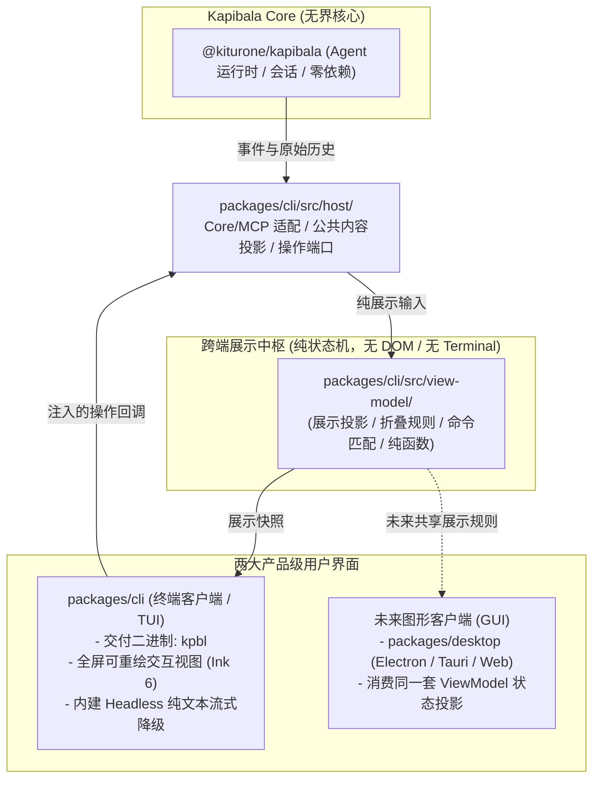

# Kapibala v0.0.8 终端客户端 (TUI) 与跨端展示架构设计

状态：2026-10-17 修订技术方案。当前工作区版本为 0.0.7；阶段 A 已验证候选产物、输入适配和终端生命周期原型，完整 TUI 功能及平台验收尚未完成。实施进度以 tasks 为准，证据见 [v0.0.8 验证记录](../../verification/v0.0.8.md)。

关联：[设计基线](../../design/001-agent-framework-design.md)、[版本路线图](../../RELEASES.md)、[v0.0.7 迁移边界](../../migration/v0.0.7.md)、[OpenSpec 设计](../../../openspec/changes/v0-0-8-terminal-experience/design.md)、[实施任务](../../../openspec/changes/v0-0-8-terminal-experience/tasks.md)。本文记录技术决策；行为场景和实施进度分别以本 change 的 specs 与 tasks 为准，不能以文档齐全代替功能完成。

**核心产品形态定位**：
Kapibala 的产品界面按**终端客户端**与**图形客户端（GUI，如 Desktop/Web）**规划。CLI 描述 `kpbl` 的命令调用入口和脚本使用方式，TUI 描述其终端内的交互界面；两者可以由同一可执行文件和同一包承载，不构成拆包依据。这是本项目的交付选择，不将其他项目是否提供纯命令行模式作为前提。
- **终端客户端（CLI 包内提供 TUI）**：`packages/cli` 编译出统一的 `kpbl` 可执行文件。本版将原有基于 readline 的交互 REPL 升级为可重绘、可滚动、支持组件折叠与命令面板的 TUI。管道、CI、`-p` 单次问答及用户显式选择的 `--ui text` 继续使用同包内的纯文本通道；文本模式也可在交互式 TTY 中使用，不需要另建 CLI 或 TUI 包。这里的文本通道与 Core 的 Headless 架构约束分别描述输出形式和核心职责。
- **图形端（GUI）**：后续版本规划的桌面端（Desktop / Web / IDE 插件）采用 DOM / Canvas / 视窗技术栈。
- **跨端展示中枢（ViewModel）**：TUI 与未来的 GUI 共享会话文档、思考折叠、命令过滤与任务展示状态转换。本版在 `packages/cli` 内沉淀纯展示层 `view-model`；终端布局、桌面交互和会话执行各自保留在对应适配层，不由展示模型接管。

## 1. 目标与交付边界

本版将 `packages/cli` 升级为现代产品级 TUI 终端客户端，交付共享展示模型、统一 `/` 命令面板、思考块完成后折叠、多任务状态和可扩展状态栏。用户统一通过 `kpbl` 启动，发布包继续保持 Core、MCP、CLI 三个。

| 必须交付 | 边界 |
| --- | --- |
| 产品级 TUI 终端客户端 | `packages/cli` 内部直接实现终端组件、编辑器、布局、焦点、按键拼包与生命周期；统一二进制 `kpbl`，不新增分裂的 `kapibala-tui` 包 |
| 跨端纯净 ViewModel | 纯展示逻辑、状态转换与折叠规则，浏览器与非 Node 环境可编译；作为未来 GUI 客户端同构复用的核心资产 |
| 统一 `/` 面板 | 内置 Slash、可由用户调用的 Skill、MCP Prompt；不纳入原始 MCP Tool |
| 流式会话展示 | 正文、公开思考、工具过程、错误与取消状态；历史恢复不重放工具 |
| 键盘展开与收起 | 思考生成期间展开，块完成后默认折叠，用户选择在后续重绘中保留 |
| 多任务与状态栏 | 来源明确的子代理状态、待收集提示和真实指标，保持既有投递规则 |
| Headless 文本降级 | 单次问答（`-p`）、非 TTY、管道和 `--ui text` 模式作为终端客户端原生内建的纯文本流式降级输出 |

鼠标点击过程块增强仍按路线放在后续版本；本版不把鼠标作为操作前提。v0.0.9 的 wire DTO、Daemon、双向 RPC 和远程传输，以及 v0.1.1 的桌面窗口不在本版实现。后台自动唤醒、结果自动收集、审批冒泡、Worktree 隔离和树级 Token 账本不因界面改造而获得交付承诺。

## 2. 参考设计与已核实事实

本地参考于 2026-10-17 检查。下列外部项目路径以 `F:/Project/aigc/` 为根，仅作源码证据，不是运行时依赖；其 Git 提交身份未核实，不声称代表最新发布版本。

| 项目 | 参考入口 | 吸收的机制与限制 |
| --- | --- | --- |
| Pi | `pi/packages/tui/src/{tui,tui-alt-screen,stdin-buffer}.ts`、`components/scroll-view.ts` | 备用屏与 Synchronized Output（`\x1b[?2026h`）防撕裂；StdinBuffer 转义拼包防 Esc 误判；滚动组件仍可能渲染完整子内容，不等于视窗虚拟列表 |
| OpenCode | `opencode/packages/client/src/solid/data.ts`、`packages/tui/src/{context/data,component/command-palette}.tsx` | 界面消费客户端只读投影与待决状态（pending status）分类；候选目录与执行动作分离；不照搬其服务器和 Solid 依赖结构 |
| Codex | `codex/codex-rs/tui/src/tui/{frame_requester,windows_key_sequence}.rs`、`bottom_pane/command_popup.rs` | FrameRequester 微帧合并削峰；Windows ConPTY CSI-u 组合键（Shift+Enter）拆包拼接；命令别名去重与选择窗口；不引入 Rust 宿主或其传输协议 |
| Claude-Code（非官方还原版） | `Claude-Code/README.md`、`package.json`、`src/ink/` | 本地仓库声明由 source map 还原，部分模块使用 shim，并含自定义 Ink 分支；可参考终端客户端组织和交互思路。其声明 Node >=24、依赖版本多为通配符，不能作为标准 Ink 6 或 Node 20 兼容性的验收证据 |
| DeepCode | `deepcode-cli/packages/cli/src/ui/core/thinking-state.ts`、`ui/views/App.tsx`、`package.json` | 参考思考块默认展开规则；单一 expandedId 不足以表达历史块的用户手动展开覆盖。本地配置为 Ink 7、Node >=22，这只说明该快照的依赖要求，不证明其升级历史或本方案候选已通过 |

Kapibala 现有接点如下：

- `ui/events.ts` 混合事件解释、过程缓存、脱敏、ANSI 回写和指标展示；应拆职责，保留文本渲染兼容入口。
- `CliInputCoordinator` 原先在构造时创建 readline，属于简单 REPL 原型的过渡产物；在 TUI 客户端架构下，终端交互由 TUI 输入引擎统领，非交互环境直接调用纯文本输出，消解“两个输入所有者争夺”的旧设计矛盾。
- `CommandDispatcher` 已有定义目录、参数校验、变更互斥和 busy 门禁，但命令处理器仍有直接终端输出，且面板尚未在 busy 期对变更命令做视觉禁用提示。
- `SessionEvent` 的增量并非全部带消息身份；`message_stop` 和 `tool_messages` 是 canonical 完成事件，不能重复追加已显示内容。
- `run_finish` 在运行 finally 的记录写入和 `activeRun = false` 之前发出；运行结果事件不等于清理和解锁完成。
- `AgentRuntime` 有任务快照和内部状态监听机制，但没有可直接作为公共宿主订阅使用的接口。
- `scripts/dev.mjs` 已动态扫描 `packages/*` 并修复声明依赖的链接，无需为本版新增一套包拓扑。
- 根类型检查与现有发布清单显式覆盖三个包；本方案保留包数量，仅增加 CLI 内部源码和独立展示层构建检查。

## 3. 包内分层与跨端设计

### 3.1 目录组织与双端格局

图中箭头表示数据与操作流，不表示 Core 导入展示层。静态依赖以以下分层约束为准；细小文件可由实现者合并，分层边界不可反转。未来 GUI 另配宿主与传输适配，本版不实现它们。

| 目录 | 负责 | 不能依赖或执行 |
| --- | --- | --- |
| `packages/cli/src/view-model/` | 展示类型、状态转换、选择器、折叠规则、命令匹配（TUI 与未来 GUI 共享） | Node 内建模块、Core 运行时、React、终端 I/O、ANSI、DOM、文件读写 |
| `packages/cli/src/tui/` | 终端组件、布局、虚拟滚动、编辑器、绘制及终端底层能力（ANSI/备用屏/按键拼包） | Session 创建、模型请求、工具执行、MCP 配置解析、权限裁决 |
| `packages/cli/src/host/` | 将 Core 事件和历史转换为 ViewModel 展示输入，绑定命令、审批、会话和任务操作 | 复制 Core 的执行状态机或绕过现有执行门 |
| 既有 `oneshot.ts`、文本渲染入口 | TUI 客户端在非 TTY、管道或单次问答下的 Headless 文本降级流式输出 | 为打印历史而重放工具，截断 detailed 标准输出 |

依赖方向为 CLI Host → Core/MCP 公共接口；Host → ViewModel；TUI → ViewModel 和终端库。Host 通过回调将用户动作接回现有控制器。Core/MCP 不得反向依赖这些目录。ViewModel 使用自己的展示契约，由 Host 适配 Core 类型。

### 3.2 为未来 GUI 客户端预留的复用契约

未来 GUI 客户端可复用 `view-model` 中定义的会话文档、块级折叠规则、命令过滤匹配算法与任务展示聚合。同一输入契约应产生一致的语义状态；各端的布局、焦点、快捷键和无障碍交互由各端适配，不承诺界面或交互方式完全相同。投影输入是包内展示契约，不代替 v0.0.9 的传输 DTO、认证或远程执行协议。

本版在 CLI 包提供独立 `@kiturone/kapibala-cli/view-model` ESM 子路径及类型声明，只有纯展示模块可从该入口导出。桌面端未来只导入这个子路径；加载它不能加载 CLI 根入口、执行 `main`、注册信号监听或拉入 Core/MCP/终端库。

构建将该子路径与可执行入口分别配置：不带 shebang、不含 Node 内建依赖，类型检查使用独立的非 Node 环境。用浏览器目标构建和产物导入测试验证边界。后续在启动独立 GUI 项目时，若有独立 npm 发布诉求，可将该目录顺水推舟提升为 `@kiturone/kapibala-view-model`，v0.0.8 无需预先拆包增加工作区维护开销。

## 4. 终端依赖与准入决策

默认保留 CLI/Core/MCP 现有 Node `>=20` 兼容声明；本轮没有获得提高最低运行版本的决定。优先验证 **Ink 6 系列 + React 19 的兼容组合**，以 `ink@6.8.0` 和 `react@19.2.4` 为初始候选，精确依赖版本在阶段 A 通过后写入锁文件。ViewModel 不依赖 React，终端渲染库差异封装在 `tui/`。

[Ink v6.8.0 官方配置](https://github.com/vadimdemedes/ink/blob/v6.8.0/package.json)声明 Node `>=20`；这一声明不代替完整依赖树、安装产物或平台验收。本地 DeepCode 使用另一版本的 Ink，不能将其运行情况直接当作本候选已通过。

**Ink 适配边界**：先核对固定候选的公开配置与实际能力，再补宿主缺口。Ink 6.8.0 已有输入序列解析、`maxFps` 限帧和受终端能力控制的同步输出；不能将 Pi/Codex 的机制再完整叠加一遍。初始化显式设置 `exitOnCtrlC: false`、`patchConsole: false`、`maxFps: 30`，由宿主处理取消/退出和应用输出。输入原始流、raw mode、最终写屏各只有一个所有者；补充分片缓冲或粘贴适配时必须在同一输入链内完成，不能再独立监听 stdin 与 Ink 争用数据。

上述能力按 [Ink 默认配置](https://github.com/vadimdemedes/ink/blob/v6.8.0/src/render.ts)、[输入适配](https://github.com/vadimdemedes/ink/blob/v6.8.0/src/components/App.tsx)、[渲染实现](https://github.com/vadimdemedes/ink/blob/v6.8.0/src/ink.tsx)核对；是否覆盖本项目目标终端，仍须阶段 A 实测。Host 合并状态发布与 Ink 实际限帧分别负责应用订阅和写屏，不再增加第二套独立的 33ms 写屏调度器。

当前本地 Pi TUI 声明 Node `>=22.19.0`，暂作设计参考；不以删除 engines 校验或隐藏版本差异的方式接入。OpenTUI 的运行时/原生资源要求另有成本，不作为本方案首选。依赖只进入 CLI，Core 保持零第三方运行时依赖。

阶段 A 必须验证：Node 20 与当前开发 Node 24、Windows/POSIX 上的安装和运行、中文 IME 光标位置、组合字符、粘贴、固定视窗滚动、历史展开、窗口缩放、信号退出与打包后资源解析。确认候选能够承载第 8 节的界面契约后再扩展功能。失败时保留文本通道并回到选型，不擅自升级 Node 要求或另起一个通用终端框架。

## 5. 展示状态与事件对齐

### 5.1 数据与身份

ViewModel 区分会话展示文档、当前运行状态、交互状态、任务快照和主机环境状态。它是可重建的只读展示投影，不是新的历史存储；不写回 canonical，不修改消息 Schema，也不作为恢复授权的依据。

Host 适配后的输入包含所属 `conversationId`、`branchId`、本地 `operationId`、`viewEpoch` 与递增事件序号。运行身份不冒充 Core runId，本版也不把这个包内输入契约定义为 v0.0.9 wire DTO。会话/分支重载先推进 `viewEpoch`；旧代次的迟到事件和异步命令结果不得更新新视图。

开始运行时由 Host 记录新加入历史的用户消息；恢复和切换读取当前分支的 `getHistory()`，而不是 `getContextHistory()` 的压缩模型投影。原始会话历史始终由 Core 保存。

正文、公开思考、工具、系统通知、错误各有 UI 块身份。正文增量使用本地临时身份，思考优先使用流内 `blockId`，工具使用调用 ID；所有流内身份都按运行和视图代次隔离。不得用正文 hash 合并内容相同的不同块。

### 5.2 临时内容与提交内容

`text_delta` 和 `thinking_delta` 追加到本轮暂存块；`message_stop` 依据 canonical 内容替换或对齐相应暂存消息，不再追加一份。对齐保留 UI 块身份别名和用户折叠选择；工具开始可能早于 assistant canonical 完成事件，不能等 `message_stop` 才显示工具状态。

`tool_start` 创建过程块，`tool_progress` 更新进度，`tool_finish` 标记已观察到的执行结果，`tool_messages` 对齐 canonical 结果。执行完成不自动表示整个运行已安全持久化。批量工具结束顺序可以不同，按调用 ID 对齐。

流中断时保留已显示片段并标为未完成；若因网络异常、超时或用户强制取消导致缺失 `thinking_block_stop`，Host 在收尾（`run_finish` 或 `error`）时依据未闭合的 `blockId` 合成本地中断终态，使思考块停止等待并转换为中断折叠态，避免 UI 无限期挂在旋转流式中；若 Core 没有持久化相应 assistant 消息，不伪造历史，恢复后也不声称还能找回这段临时正文。操作结束后从历史校对本轮已提交内容，并保留必要的错误提示。

### 5.3 运行与清理

运行展示阶段为 `idle / running / cancelling / settling`，最终结果另记 `completed / failed / aborted`，二者不混用。

- 收到 `run_finish` 后更新指标和结果，进入 `settling`，继续消费迭代。
- 取消只发送 AbortSignal，展示 `cancelling`，保留执行门。
- Host 必须等完整迭代、相关 finally 和 ActiveSessionController 执行门释放后发出本地 `operation_settled`，再回到 idle。
- `run_finish` 后抛出落盘/清理异常时显示失败诊断，不能保留“全部成功保存”的提示。
- 视图卸载或绘制异常不得随意 break 迭代；关闭路径取消并等待工具清理、历史闭合与资源释放，沿用现有控制器。

## 6. 统一输入、审批与输出

### 6.1 模式选择与生命周期

新增 `--ui auto|tui|text`，默认 auto；非法值在会话副作用之前报错。普通交互在 stdin/stdout 都是 TTY 且终端能力可用时选择 TUI；单次问答和非 TTY 使用文本输出。显式 tui 与单次问答或不可交互环境冲突时明确报错，auto 的启动失败可诊断后回退文本。权限和信任检查沿用原入口。

启动阶段与运行阶段共用宿主输入接口，可以分阶段更换底层实现。进入 TUI 模式时，原有的 `CliInputCoordinator` 必须在 TUI 接管 stdin 之前完整 close、解绑全部按键与信号监听并等待清理完成，杜绝两套读取器并发抢占同一个 stdin。

Session factory、MCP 重连和切换会话后的授权必须通过当前宿主输入端口取值，不能闭包捕获已经关闭的启动期 coordinator。auto 初始化失败只在尚未受理用户任务、渲染器已停止且模式恢复完成后切回文本；回退时重新绑定有效端口，不复用已关闭实例，也不重放已经开始的模型或工具操作。

**终端生命周期分三条路径**，不能将收到信号直接等同于退出备用屏：

| 路径 | 处理与恢复时机 |
| --- | --- |
| 任务或问答取消 | raw mode 下的 Ctrl+C 通常是输入字节 `0x03`，外部 SIGINT 也经宿主中断状态机分派。按第 6.2 节取消问答/任务或提示退出；取消任务时继续持有备用屏、raw mode 和执行门，等待清理，保留终端客户端继续使用能力 |
| 正常关闭 | `/exit`、确认退出或可处理的 SIGTERM 进入同一幂等关闭流程：拒绝新操作、取消并等待控制器/后台任务清理、停止动画与在途绘制、卸载渲染器，再恢复本宿主持有的终端模式并解除监听。信号退出保留约定的非零退出状态，普通用户退出沿用既有状态规则 |
| 致命异常或最终 exit 兜底 | 使用 `uncaughtExceptionMonitor` 和最终 `exit` 钩子尽力执行同步、幂等的终端恢复；不安装仅恢复终端后继续运行的 `uncaughtException`/`unhandledRejection` 处理器，不吞掉 Node 默认致命错误或覆盖其非零退出行为。此路径不等待异步 Session/工具清理，也不宣称历史已完成落盘；残留按既有崩溃恢复规则处理 |

终端模式守卫在首次变更模式前登记，记录进入前 raw mode 以及本实例实际启用的备用屏、光标、粘贴/键盘协议状态。恢复只作用于本实例持有的 TTY 资源，raw mode 还原到进入前状态；写屏或句柄失效时尽力结束，不能再次抛错形成清理递归。正常卸载与同步兜底共享模式状态，防止重复退出备用屏后又恢复绘制。`--help`/`--version` 不加载交互渲染器。

SIGKILL、原生强制终止、部分 OOM/运行时崩溃和终端连接断开无法保证执行 JavaScript 清理钩子，因此不承诺所有退出场景都能恢复屏幕。平台验收分别记录可处理退出和不可捕获退出的边界，不把故障注入后的进程终止等同于清理完成。相关约束参见 [Node 信号事件](https://nodejs.org/api/process.html#signal-events)和 [uncaughtExceptionMonitor](https://nodejs.org/api/process.html#event-uncaughtexceptionmonitor)。

### 6.2 输入与焦点

交互状态分别表示聊天编辑、命令面板、菜单、普通问答、审批和秘密输入；独占问答期间不提交聊天或执行命令。弹层取消后恢复之前的草稿，审批/秘密的输入缓冲不并入草稿或历史。秘密值只留在宿主的短生命周期输入对象中，不进入共享状态、终端快照、日志或导出。

**输入序列与粘贴适配**：借鉴 Pi/Codex 的完整序列处理思路，先验证 Ink 已有解析能否正确处理跨输入块的 CSI/功能键序列。目标是将完整组合按键（如支持相应协议的终端发出的 `Shift+Enter` CSI-u `\x1b[13;2u`）只分派一次；不假定每个 Windows/POSIX 终端都发送该格式。

若实测仍存在独立 Escape、分片序列或 Bracketed Paste 的缺口，在唯一输入链中增加有界缓冲适配；10~50ms 仅作为待测的 Escape 等待窗口，不能无差别延迟所有字符，也不能与 Ink 内部解析各自建立读者/计时器。补丁需明确字节上限、序列等待超时和关闭时的缓冲处理，非法控制序列不得重放为会触发 Enter/审批选择的快捷键。Bracketed Paste（`\x1b[200~` ... `\x1b[201~`）的内容作为编辑文本提交，多行粘贴不能自动发送聊天、执行 Slash 命令或批准工具；粘贴模式的开启与恢复由同一终端模式守卫管理。

Esc 关闭面板/取消弹层，不隐式取消模型任务。Ctrl+O 保留本轮过程详情切换，独占问答期间禁用；单块操作通过过程块焦点及 Enter/Space 执行。Ctrl+C 优先取消当前独占问答；没有问答时，运行中请求取消并等待清理，空闲有草稿时清空草稿，空闲无草稿时提示退出；短间隔第二次 Ctrl+C 或 `/exit` 请求正常关闭并等待清理，不直接绕过控制器退出。双击间隔建议沿用现有 REPL 常量，具体值由实现者保持一致。

### 6.3 审批与命令输出

保留 `CliApprovalChannel` 与 Core 的审批裁决。TUI 只展示目标并返回既有 ApprovalChoice；取消、EOF、关闭和非交互按既有规则拒绝/取消。完整命令、解释器、工作目录和参数可滚动检查，转义控制字符；不能只展示截断摘要或用脱敏后的执行参数替换真实审批目标。

命令处理器、调度器、MCP 和后台诊断统一通过宿主注入的输出接口展示，逐项替换会话运行期间直接写终端的调用。文本模式映射到原有 stdout/stderr；TUI 映射为通知、列表、弹层或诊断面板。实际写屏统一交给渲染器；不能用全局 monkey patch console 隐藏遗漏入口。

## 7. 统一命令面板

候选提供方由 Host 查询 `CommandDispatcher.getDefinitions()`、当前 Session 的 Skill 元数据、当前 MCP Prompt Registry。ViewModel 只接收候选列表，不扫描文件、不拉模板或注册工具。

候选含稳定 ID、名称、描述、来源、参数提示、可用性及执行引用。命令使用 `command:<canonical-name>`；Prompt 使用经过无歧义编码的 server/name 身份；Skill 使用 Host 为当前获胜元数据计算的身份，输入为 name、scope、规范化的 discoveryRoot/discoveryPath，并使用无碰撞的字段编码，不假设 Core 已提供 `catalog-id`。路径规范化与现有信任身份保持一致，Windows 物理路径使用 native realpath 语义。绝对路径只在 Host 内作为身份输入，共享候选只携带不透明 ID 和允许展示的来源标签。

候选稳定身份与新鲜度分开：Skill 的 contentDigest、当前目录代次及 Prompt 连接/目录代次由 Host 保存并在执行前重新核验，不将内容更新简单等同于同名旧候选仍有授权，也不因正文摘要变化无条件丢掉当前选择。来源替换或候选撤销时撤销陈旧选择；ViewModel 不直接读取路径、摘要或连接状态以作权限裁决。

**别名去重与默认列表清洁（参考 Codex）**：同义内置别名（如 `quit` 之于 `exit`）在默认裸 `/` 弹出的候选列表中隐藏，仅展示规范主命令；只有当用户显式输入的搜索前缀命中了别名（如输入 `/qui`）时才激活呈现，防止默认面板被重复动作占满。Skill 需 userInvocable、available 且未禁用；Prompt 显示其连接/目录状态，不将故障冒充成功空集。

匹配按精确、前缀、子串、模糊四级；同级按稳定基础顺序排列。裸 `/` 先按命令目录的策划顺序，再按 Skill 稳定身份、Prompt 的 server/name 排序，避免异步发现顺序抖动。名称为主匹配字段，描述和来源仅作同级辅助；不引入使用频率重排。

默认可见 3 条但候选完整保留，上下键滚动、显示 `+N more`。Tab 补全当前候选并保留编辑，Esc 关闭且不清空文本；Enter 对参数齐全的候选执行，对必填参数缺失的候选进入参数编辑。输入已存在时保持原参数，不重复拼接。未知命令仍由 dispatcher 明确报错，不自动作为模型提问发送。

**Busy 态分级交互与防重入**：禁用与否按具体调用参数判断，由 Host 复用 `CommandDefinition.mutates(args)` 和 dispatcher 当前使用的执行门条件：控制器/Session busy、输入独占及变更命令互斥。`running / cancelling / settling` 均不能提前放行变更；会话准备/切换和已开始的变更命令也不能仅因 ViewModel 显示 idle 就被忽略。ViewModel 只接收 Host 算好的可用性，不导入命令实现或自行硬编码变更命令名单。

因此 `/branch` 无参、`/archive list` 与 `/status` 等只读调用在无独占问答时仍可用，而 `/branch switch ...`、`/archive restore ...`、`/model <id>` 等变更调用在忙碌时置灰并显示原因。尚未填写参数的候选允许先进入参数编辑，参数变化后重新判断；当前已确定不可执行的调用按 Enter 只给出提示并保留输入。独占审批/秘密输入期间仍按第 6.2 节禁止分派其他命令。最终执行必须再次通过 dispatcher 校验，UI 的禁用提示不替代运行时裁决。

执行映射沿用现有入口：Slash → dispatcher；Skill → `/skill` 既有解析和运行控制器；Prompt → `/prompt <server/name> <arguments-json>` 的校验与受控准备。Prompt 参数使用 JSON 编辑/表单转 JSON，维持未知参数/必填参数检查。进入执行前重新获取候选、核对目录代次、模式、权限和 busy 状态；菜单可见不等于已经获准执行。

## 8. 会话视图、折叠与性能

### 8.1 视窗与操作

完整 TUI 使用应用持有的备用屏视窗；上部为可滚动消息，中间按需显示候选/问答区域，底部为编辑器和状态栏。窄屏布局保留正文与输入，将次要字段折叠成可查询详情。用户向上浏览时暂停自动跟随，显示新内容提示；回到底部后恢复跟随。

键盘支持 PageUp/PageDown 浏览历史；编辑器之外的消息浏览焦点可按 Tab 切换过程块，Enter/Space 展开当前块，Esc 返回编辑器；编辑器中的 Tab 优先用于命令面板补全。焦点协议明确区分命令面板、消息浏览与编辑器，避免同一按键执行两次。

退出默认恢复原屏幕并打印简短的会话 ID/恢复命令，不重新打印整段历史；需要完整文本时通过文本模式或已有可用的输出机制获取，不新增隐式历史重放。

### 8.2 思考与工具

只展示 Provider 明确公开的思考内容。Host 白名单投影公开正文与过程，剥离 signature、redacted_thinking 私有载荷、provider_state 和加密 reasoning 内容；不把通用对象 JSON.stringify 当作展示投影。

思考块生成期间展开；`thinking_block_stop` 后默认折叠，缺少 stop 时在消息或操作收尾标记对应完成/中断状态。用户显式展开/收起优先于默认策略，后续 delta/重绘不能清除其选择；会话内按稳定 UI 身份保存，恢复后默认重新计算，不将折叠偏好写入 canonical。

工具调用复用既有动作命名、敏感字段脱敏、错误分类和耗时口径。参数/结果详情默认折叠，错误和需要用户动作的提示可见。审批卡片与过程详情分别处理，审批必须能检查完整目标。

### 8.3 刷新与资源预算

所有事件先完整进入状态转换，绘制请求合并到帧；默认最大 30 帧/秒，终态和输入变化请求下一帧。

**同步输出（Synchronized Output）**：优先复用 Ink 的终端能力判断和同步输出写屏逻辑，不在每次 stdout.write 或已有同步帧外重复包裹 `\x1b[?2026h` / `\x1b[?2026l`。如准入发现候选能力不足，补丁只能归属唯一写屏适配器，明确配对、失败恢复和禁用策略。目标终端不支持或能力无法确认时使用普通差量刷新；同步输出用于降低帧间撕裂，不承诺所有终端零闪烁或所有协议序列都无兼容副作用。

**状态发布与绘制合并（Frame Coalescing）**：事件按序完整应用到 ViewModel，Host 合并订阅通知，避免每个 delta 都触发整树 React 更新；由 Ink 的 `maxFps: 30` 约束实际绘制，不再叠加独立的周期性写屏定时器。若为减少 reducer 开销暂存增量，必须在 `message_stop`、`tool_messages`、错误、终态及视图切换前按序排空，旧代次回调取消，不能在完成事件之后补入旧 delta。输入和终态优先请求下一可用帧，不等待额外批处理窗口；响应延迟按基准测试评估，不承诺零延迟。

**视窗级虚拟滚动（Windowed Viewport）**：TUI 只挂载覆盖实际可见行和 overscan 的消息组件，窗口按消息换行后的行范围计算。默认上下各一屏 overscan，资源紧张时先减少 overscan；不能为满足固定节点数而遗漏仍在屏内的内容。单条超大消息按行片段渲染，不能因为它只有一个消息节点就一次排版全文。

终端行高索引、可见窗口、占位、Markdown 终端行和布局缓存均放在 `tui/` 的终端展示适配层；共享 ViewModel 只保留语义内容、稳定块身份、revision 和折叠选择，不存终端列宽、行高或 ANSI。不可见历史保留可重建的源和轻量索引，不为每条历史继续挂载组件；静态行缓存也不使用无法原位更新的 Ink Static 作为永久滚动记录。宽度或折叠变化时使相关布局失效，并按稳定消息/块身份及块内偏移保持浏览锚点；不得每个 delta 遍历全部历史或整段重解析 Markdown。

初始工程预算：活跃过程详情额外缓存 1 MiB，布局缓存 8 MiB；活跃节点数随实际窗口动态计算并记录峰值，不设固定 30 个节点的截断门槛。可见行覆盖优先于 overscan 数量，淘汰仅回收不可见派生对象，返回窗口时从保留的展示源重建。缓存压力不能导致可见正文消失或将尚未完成的块误标为完成。

缓存预算不限制 canonical 数据或回答完整性，也不使目前全历史加载的 Core 变为总内存有界。文本 detailed 输出不通过该缓存，因此不受截断影响。共享投影避免深拷贝整个历史；详情未载入时明确标识，不伪造可展开全文。

基准场景至少覆盖：1,000 条消息的历史切换/滚动、超过 60 行的高终端内连续短消息、1 MiB 单块、每秒 100 次 delta 持续 30 秒、工具交错完成和 20 次宽度切换。验证高终端中可见短消息超过 30 个时仍完整显示，宽度/折叠变化后浏览锚点稳定，合成事件的投影内容无遗漏。在记录机器/终端的参考环境中，键盘响应 p95 目标小于 100ms，不把本机样本当作所有终端保证。准入未达标先修缓存与窗口策略，不通过删除历史或丢 delta 达标。

## 9. 后台任务与状态栏

Core 可新增通用 `AgentRuntime.subscribeTaskChanges(listener)`：返回取消订阅函数，订阅后宿主读取过滤快照；通知只表示状态变化，不携带终端格式。监听器失败不得破坏任务执行，关闭时释放订阅。本版不开放可变任务对象给 UI，Host 复制允许展示的摘要字段。

按当前父会话/rootTaskId 过滤任务，显示来源分支；异分支只提示，保持 `/agents collect` 的显式投递和分支检查。任务执行终态与结果投递状态分别展示：完成、失败、取消和中断不等于已收集。子任务终态通知不自动唤醒父模型或请求审批。

状态栏使用可组合的纯展示段：段 ID、文本、隐藏优先级和详情引用。Git、模型、权限模式、运行/清理阶段、上下文占用、当前运行指标和后台任务摘要由 Host 提供；不允许状态栏渲染时自行启动命令或读取文件。Git 探测缓存并异步更新，失败省略，不能阻塞流式输出。

上下文占用读取真实快照，run 累计 Token 单独展示，不能混为窗口占用；子代理无可靠账本时显示未知或省略，不能将任务快照相加冒充已完成树级计费。窄屏优先保留执行状态与必要操作提示，次要指标可通过 `/status` 查询。

## 10. 工程接入与实施顺序

不新增 package.json 或发布单元，Core → MCP → CLI 的 npm 发布拓扑与版本推演保持原有单一实现。CLI 可增加终端依赖、ViewModel 子路径及构建入口，打包校验仍必须覆盖最终 manifest 与浏览器入口的依赖闭包。

根类型检查已经包含 CLI 源码；若候选使用 TSX，需要配置 JSX 转换、React 类型以及相应测试文件匹配。另加 ViewModel 独立无 Node 类型检查和浏览器产物检查。架构门禁扩展为：Core/MCP 禁止反向导入 CLI；ViewModel 禁止 Node/React/宿主依赖；TUI 禁止创建 Session 或导入 CLI Host/命令实现。不能仅通过 Core 零依赖检查就宣称新边界已受保护。

| 阶段 | 交付物与退出条件 |
| --- | --- |
| A：终端准入 | 固定候选依赖、Node/平台安装和 Ink 能力核对；验证 `exitOnCtrlC: false`、`patchConsole: false`、`maxFps: 30`、唯一输入/写屏链及 IME/备用屏/滚动；记录 CSI-u/粘贴缺口、同步输出支持与降级和可处理退出证据；未通过不能扩展功能 |
| B：展示契约 | ViewModel、Host 事件适配、canonical 对齐、viewEpoch 隔离、未闭合思考块合成补偿和独立浏览器入口测试 |
| C：交互适配 | 单一输入接管迁移（readline 完整解绑）、统一输出、向导/秘密/审批；验证任务取消不退出终端、正常关闭等待清理、致命异常同步兜底且非零退出；消除运行期旁路终端写入 |
| D：产品功能 | `/` 面板（含参数级 Busy 判定与别名去重）、流式 Markdown、思考/工具折叠、按实际行窗口虚拟滚动、状态发布与 Ink 绘制合并、任务订阅和状态栏 |
| E：交付验证 | 完整 `pnpm verify`、最终 tarball 安装、文本输出、目标平台交互和性能基准记录（含 100 delta/s 持续 30s 压力下 p95 < 100ms） |

Windows 与 Linux 现有 CI 继续运行，macOS 需补终端实测记录或可复现的验收任务。Node 20 验收应使用支持该运行时的工具执行产物/测试，不假定当前 pnpm 12/开发工具链自身能在 Node 20 上运行。`--verify-only` 继续调用与 `pnpm verify` 相同的全量校验源。

## 11. 验收矩阵与当前证据

| 类别 | 必须证明 |
| --- | --- |
| 事件一致性 | 多工具逆序结束、delta/完成去重、无 stop 的中断补偿合成、提交失败、恢复及分支切换不串消息 |
| 生命周期 | `run_finish` 后仍保持执行门；Ctrl+C/外部 SIGINT 取消任务后终端仍可使用；正常退出等待清理后恢复持有模式；致命异常尽力同步恢复并保持非零退出，明确不可捕获退出的边界 |
| 输入与审批 | 单一 stdin 读者干净交接、Ink 解析能力及按需补丁、支持终端上的 CSI-u 与 Bracketed Paste、粘贴不自动提交/批准、中文/组合字符、弹层草稿恢复、秘密不泄漏、完整目标可检查、EOF 安全结束 |
| 面板 | 三类来源、同名隔离、稳定排序、三行窗口不截集合、别名去重；参数级 mutates 与实际执行门一致，覆盖 cancelling/settling/变更互斥和只读子命令；参数编辑后重算可用性，执行时复核撤销/权限/代次 |
| 展示 | 思考流中展开与结束折叠、用户显式覆盖、稳定块焦点、受支持终端的同步输出与不支持时降级、无重复帧包裹、缩放后定位、浏览历史不被强制拉回底部 |
| 任务与指标 | 正确来源过滤、空闲刷新、显式 collect、清理阶段真实可见、未知 usage 不伪造 |
| 兼容与打包 | Node 20/24、Windows/POSIX、无 ANSI 管道、detailed 完整输出、无副作用 ViewModel 子路径、Core 零依赖 |
| 资源预算 | 实际行窗口虚拟滚动与单一绘制限帧；高终端超过 30 个可见短消息仍完整显示；长历史/大块/事件风暴下内容完整、缓存可回收、布局不进入共享 ViewModel，参考环境输入响应延迟 p95 < 100ms 留档 |

2026-10-17 已运行现有类型检查与架构门禁，均通过。9 个文件共 81 项相关基线测试首轮 80 项通过，1 项因测试默认写用户目录的审计失败触发 AUDIT_UNAVAILABLE；对该文件隔离测试用户目录后 8 项全部通过。独立受控 Provider 复现确认 user/assistant/tool/assistant 四条落盘、run_finish 时 busy 为 true、迭代结束后 busy 为 false。测试未调用真实模型。

上述测试是规划审阅时记录的既有实现支撑证据，不是 v0.0.8 功能验收。后续工作区已建立 OpenSpec 提案、六份场景规范和 53 项实施任务，并出现隔离依赖准入目录及终端模式守卫原型；这些产物不证明候选依赖、真实终端或完整功能已通过。实施勾选与最终验证记录分别跟踪任务完成和验收证据，依赖准入、浏览器子路径、平台交互与性能预算均需验证后才能标记完成；版本仍为 0.0.7。

## 12. 决策记录与后续边界

- **已确定的产品与架构定位**：统一 `kpbl` 入口在同一 CLI 包内承载 TUI 和文本模式，后续再提供 GUI。CLI 与 TUI 描述调用入口与交互形式的不同侧面，v0.0.8 不新增 `kapibala-tui` 或其他发布包；显式文本模式、单次问答和管道能力继续保留。
- **跨端展示公用资产**：`packages/cli/src/view-model/` 承载 TUI 与未来规划 GUI 共享的纯展示文档、块级折叠状态机与命令过滤逻辑，在同包内通过独立子路径 `@kiturone/kapibala-cli/view-model` 导出（无 Node/DOM/React 依赖），为未来图形客户端做好资产储备与同构保障。
- **本文工程决策**：`packages/cli` 内部采用 Host / ViewModel / TUI 三层分工、维持 Node 20 兼容底线、优先验证 Ink 6 + React 19 组合；复用 Ink 输入解析/同步输出/限帧能力并按实测补缺口，显式关闭自动 Ctrl+C 退出与 console 劫持，取消/关闭/致命异常分别处理，终端布局留在 TUI 内并按实际可见行确定虚拟窗口。
- 依赖精确版本、编辑器组件实现和细小文件粒度由实施者在阶段 A/B 内确定，须满足本文对外行为与兼容门槛；不能据此扩大版本范围。
- 提高最低 Node、替换公开命令语义、引入新发布包、将鼠标或自动结果投递纳入本版，都需要先更新方案并取得对应范围决定。
- 本 change 的 OpenSpec 提案、六份场景规范和实施任务已经建立。方案修订应同步检查这些规划产物；仅按实测证据勾选任务。撰写或修订方案不代表功能完成，也不构成 Git 提交、推送或发布授权。
